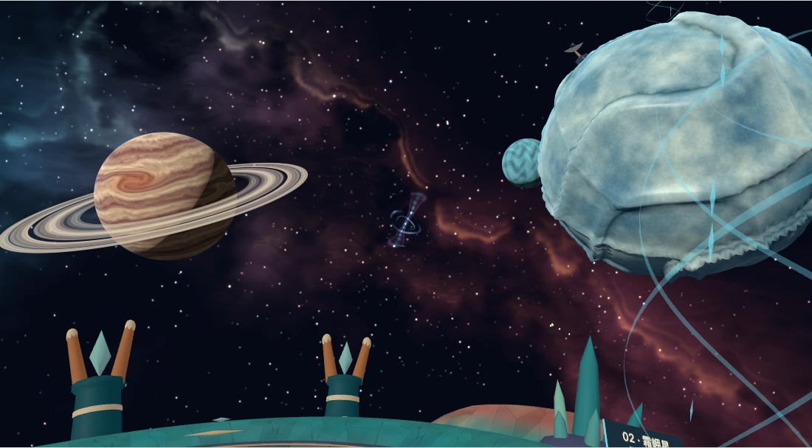
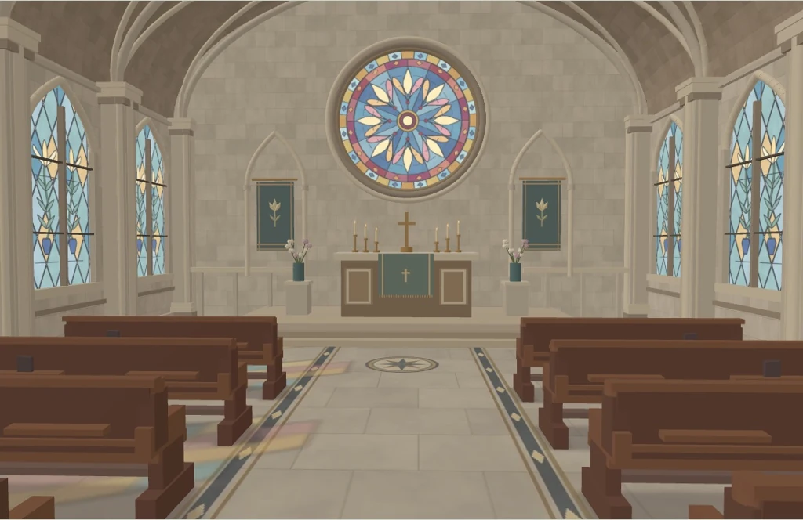

<div align="center">

# MMD XR Stage

**A standalone WebGL + WebXR MMD showcase built for Meta Quest.**

[](https://react.dev/)
[](https://threejs.org/)
[](https://immersiveweb.dev/)
[](./LICENSE)

[Open the stage](https://mmd-xr-stage.pages.dev) · [Documentation](./docs/README.md) · [Deployment notes](./docs/deployment.md)

</div>

Bring your own characters, props and motions into a shared 3D stage. Watch on a regular screen with a mouse or touch, or step into the same set in VR on Meta Quest.

## Import to the backpack, then place on stage

1. Drop a folder, ZIP or loose files onto the prep page. Keep models and their textures together. PMX/PMD files are characters, GLB/glTF files are props, and VMD/VPD files supply motions or poses. The [offline Windows converter](./docs/gameplay/blender-characters.md) turns a supported Blender character into a stage-ready ZIP with a PMX model, textures, facial shapes and supported rigid-body constraints.
2. Choose **Watch on screen** or enter VR. A fresh stage starts empty. Open the **Backpack**, pick a character or prop, and point to a free spot to place it. Select a placed character to assign a motion, turn it or change its size.
3. To swap characters, put one back in the backpack and place another. You can return to a set’s layout while the tab stays open. Refreshing clears the backpack and layouts; preferences are stored locally.

**The backpack has no separate model-count limit.** For example, you can import ten character models and choose which three to place. Each active set supports **up to three placed characters and three imported props at once**. Hiding a character keeps its slot; putting it away frees the slot. Built-in scenery does not use these slots.

Import budgets apply to files, including textures and ZIP contents: **4,096 entries, 256 MiB per file and 512 MiB total imported data**. Files stay on your device. The import report identifies missing textures and conflicting paths before you enter.

## Stage gallery

Select a scene to open it in the screen viewer.

| [Opal star system](https://mmd-xr-stage.pages.dev/?set=glassPlanet&view=screen) | [Window-side classroom](https://mmd-xr-stage.pages.dev/?set=classroom&view=screen) |
| :---: | :---: |
| [](https://mmd-xr-stage.pages.dev/?set=glassPlanet&view=screen) | [](https://mmd-xr-stage.pages.dev/?set=classroom&view=screen) |
| **[Pool terrace](https://mmd-xr-stage.pages.dev/?set=pool&view=screen)** | **[Dawn Chapel](https://mmd-xr-stage.pages.dev/?set=chapel&view=screen)** |
| [](https://mmd-xr-stage.pages.dev/?set=pool&view=screen) | [](https://mmd-xr-stage.pages.dev/?set=chapel&view=screen) |

[Opal field guide: seven wind routes, three stepping-stone moons and the mineral survey](./docs/scenery/opal-planet.md) · [All sets and routes](./docs/scenery/README.md)

## Features

### Interactive props

Fly a kite from a character’s wrist, send a ferry across the pool, dye a concert backdrop or stamp a lunar postcard. The [gameplay guide](./docs/gameplay/README.md) lists the controls for each activity.

### Prep page

- Import preserves relative paths to textures and external glTF buffers. The [import guide](./docs/gameplay/asset-workflow.md) covers filename encodings, conflicting paths and how to repair a missing reference.
- The prep page checks for a secure context and WebXR support before entry. Quest quality presets offer separate overrides for refresh rate, framebuffer scale, foveation, antialiasing, shadows and device pixel ratio.

### Viewing controls

- **On screen:** drag to orbit or scroll/pinch to zoom. With the view focused, use **WASD** to move, **Q / E** to turn clockwise / counterclockwise, **F / C** to rise / descend, and **R** to reset. **Tour viewpoints** jumps to a spot in the set.
- **In VR:** press **B** on the right controller to recall the viewing menu. With hand tracking, raise your left wrist and point at **Menu** with the other hand. Playback, the backpack and scenery selection are available inside the stage.
- **Movement:** under **B → More → Player**, normal mode walks on solid floors and jumps with **A**. Free mode passes through scenery; push the right stick forward to rise or back to descend. Both modes offer 1.2, 2.4, 4.8 and 8 m/s travel.
- **Local music:** optionally choose one audio file on the prep page. Play, pause and adjust its volume from the screen controls or the VR menu. Music continues across sets and stops when you exit; it has its own clock, independent of character motions.
- **Scene people:** where a set has built-in people, toggle them in **Backpack → Environment** on screen or **B → More → Environment** in VR. Your imported characters stay on stage.
- **Physics:** controller and tracked-hand colliders interact with cloth during playback and while paused. Controller contact can trigger haptics. Hiding the hand models leaves the menu rays available.
- **Diagnostics:** after exiting VR, export the JSON session report from the prep page. It records the requested settings, the refresh rate and layer dimensions reported by the session, XR frame intervals, model-update CPU time and renderer draw counts. Placement, physics switching and room restoration are timed separately. XR callback intervals are not GPU timings.

## Stack

| Area | Technology |
| --- | --- |
| Application | React 19, TypeScript, Vite |
| 3D and XR | Three.js r187, React Three Fiber 9.8, `@react-three/xr` 6.6.32 |
| MMD animation and physics | `@yohawing/three-mmd-loader` 0.8.6 (patched), Bullet WebAssembly |
| State | Zustand |
| Hosting | Cloudflare Pages |

Desktop and immersive views share the backpack and stage layouts. Only the active set mounts models and creates their Bullet worlds. Returning to a set restores its actors and motions from the saved layout. The [loader maintenance notes](./docs/three-mmd-loader-maintenance.md) document the version-matched Bullet assets and loader patches.

## WebXR requirements

Screen viewing requires WebGL 2. Immersive viewing also needs a browser and headset that support `immersive-vr`, served over HTTPS or localhost. The production renderer uses WebGL; the [WebGPU XR investigation](./docs/webgpu-xr-status.md) tracks that separate path.

The app requests hand tracking as an optional session feature. It marks VR entry as active when the renderer receives its first `XRFrame`, rather than when the session request resolves. WebGL 2 projection layers support MSAA via the antialias setting. See the [XR session lifecycle](./docs/xr-session-lifecycle.md) for startup and teardown. Controller collision and haptics target Meta Quest Browser; desktop simulation does not establish headset comfort or frame rate.

## Run locally

Use Node.js **26.12.1** and pnpm **11.20.0**.

```sh
pnpm install --frozen-lockfile
pnpm dev
```

| Command | Purpose |
| --- | --- |
| `pnpm dev` | Start the Vite development server |
| `pnpm test` | Run the Vitest suite once |
| `pnpm build` | Type-check the project and build `dist/` |
| `pnpm deploy` | Build and deploy `dist/` to Cloudflare Pages |

## Local data

Preferences persist in `localStorage`. Imported files and stage layouts stay in page memory until refresh. ZIP packages are unpacked locally with UTF-8, Shift-JIS or GBK filename decoding; encrypted archives are not supported.

## Deployment

Production uses direct upload to the existing `mmd-xr-stage` Pages project. The Git branch is `master`; the Pages production branch is `main`. The [deployment notes](./docs/deployment.md) cover the pinned Wrangler command, older open tabs and how to verify deployed assets against the tested build.

## Licensing

[Apache License 2.0](./LICENSE) · [Third-party notices](./docs/THIRD_PARTY_NOTICES.md). Character and motion assets are supplied by the viewer.
