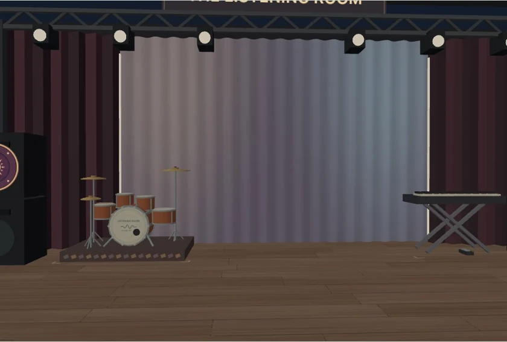
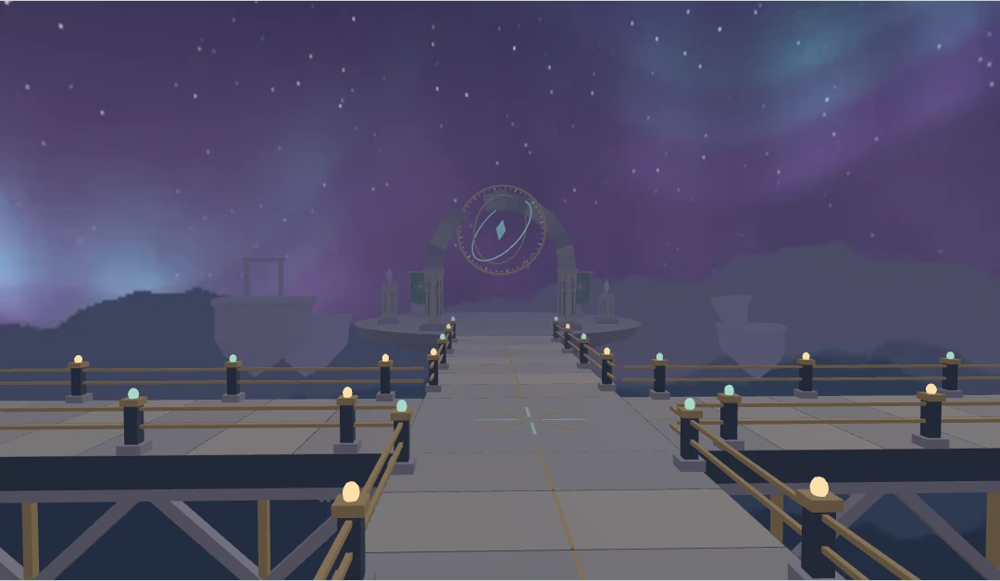
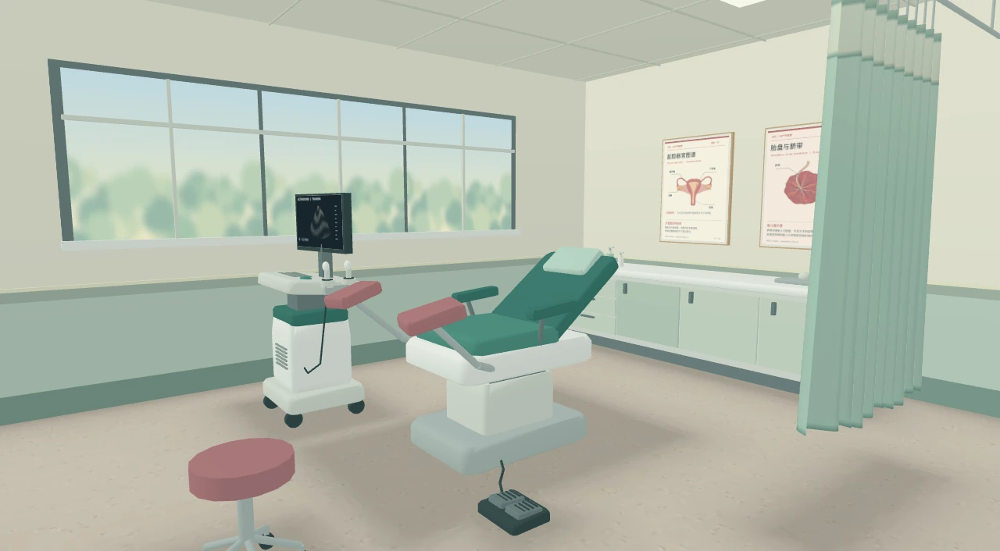
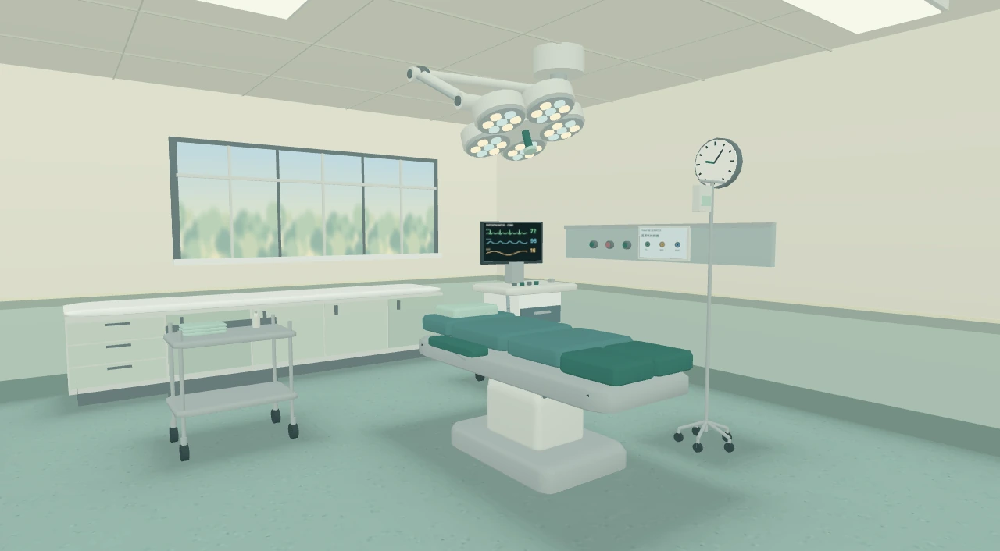
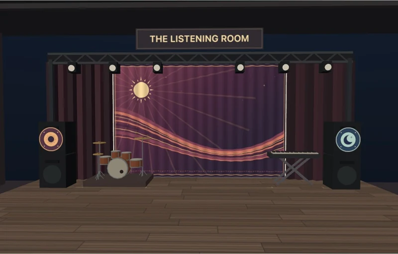

<div align="center">

# MMD XR Stage

**A standalone WebGL + WebXR MMD showcase built for Meta Quest.**

[](https://react.dev/)
[](https://threejs.org/)
[](https://immersiveweb.dev/)
[](./LICENSE)

[Live site](https://mmd-xr-stage.pages.dev) · [Documentation](./docs/README.md) · [Handoff](./docs/HANDOFF.md) · [Deployment notes](./docs/deployment.md)

</div>

Import PMX/PMD characters, VMD motions and GLB/glTF props on the prep page. Choose **Watch on screen** in a WebGL 2 browser or enter immersive VR on Quest. BGM playback is not implemented.

For a skinned Blender character, the [offline Windows converter](./docs/gameplay/blender-characters.md) can produce a stage-ready ZIP with a PMX actor, textures, facial shapes and supported saved rigid-body constraints. Import the ZIP directly on Quest or desktop.

## Stage gallery

**Qinhuai Songhouse · 泊月楼**


Follow the [river quay](./docs/screenshots/qinhuai-river.webp) into the tea hall, place a character beside the [zither table](./docs/screenshots/qinhuai-music.webp), then watch from the [upper gallery](./docs/screenshots/qinhuai-gallery.webp). The stage, stairs and gallery share one continuous set and one cast. [Route and standing spots](./docs/scenery/qinhuai.md).

**Campus passage (pilot).** Walk out of the classroom's rear door and turn left along the covered passage to enter the wisteria meadow. On screen, open **Tour viewpoints → Cross to the meadow**. Only the current zone's actors are live; the classroom resumes its own arrangement and motion when you return. [Window view](./docs/screenshots/campus-window.webp) · [Breezeway](./docs/screenshots/campus-hall.webp) · [School from the meadow](./docs/screenshots/campus-school.webp).


| Summer pool | Wisteria meadow |
| :---: | :---: |
|  |  |
| **Live House** | **Studio plinth** |
|  |  |

**Campus walk · classroom → meadow → pool**

Follow the [blue-tiled pool gate](./docs/screenshots/lido-garden-gate.webp) between the meadow bench and wisteria arbor. Take the east pool walk to the [timing deck](./docs/screenshots/lido-timing-deck.webp), or [look back at the path](./docs/screenshots/lido-return.webp). Only the district you are visiting runs its characters and physics.

**Astral Court · the observatory district**



Walk from the original star court to a copper-domed north observatory, a western chart gallery and an eastern transit telescope. All three terraces accept characters and props. In screen mode use **Tour viewpoints** for a [bird's-eye view of the route](./docs/screenshots/observatory-overview.webp) or a [closer look in the chart gallery](./docs/screenshots/observatory-west.webp).

**Dawn Chapel · the lily window above the sanctuary**


Look through the [leaded lily panes](./docs/screenshots/chapel-lily-glass.webp), follow their coloured light to the open oak doors, then walk outside. The [lavender court](./docs/screenshots/chapel-water-court.webp) has a rippling basin, a shaded arcade and a [view back to the bellcote](./docs/screenshots/chapel-bellcote.webp). The garden and nave share one layout.

Close views from the same camera, before (left) and after (right): [wisteria under the timber arbor](./docs/screenshots/wisteria-detail.webp) · [the meridian standard and enamel hour scale](./docs/screenshots/meridian-detail.webp).

**Women’s hospital · a walkable gynecology and obstetrics floor**

| Gynecology exam room | Operating room |
| :---: | :---: |
|  |  |

Walk from the [waiting hall](./docs/screenshots/clinic-entrance.webp) to the [anatomy models](./docs/screenshots/clinic-models.webp), the [four-instrument tray](./docs/screenshots/clinic-instruments.webp), or the restroom's hygiene shelf. The ward has eight original education posters, including the sagittal pelvis and [postpartum care](./docs/screenshots/clinic-postpartum.webp), and a [seated nurse at the workstation](./docs/screenshots/clinic-nurse.webp). The three new close-ups are available under **Tour viewpoints**. [Teaching exhibits and references](./docs/scenery/clinic-teaching.md).

The gallery shows the built-in sets in screen mode, except for the classroom prep-page render. All show scenery without imported characters. See [how the scenery is made](./docs/scenery/README.md) for the modelling and texture workflow.

**Handheld props:** [close-up sheet of all six in-game models](./docs/screenshots/handheld-closeups.webp), from the wound kite spool and ribbon mic grille to the stamp face and saber emitter.

## Features

### Three short scenes to play

| Kite stand | Bubble ferry | Encore print |
| :---: | :---: | :---: |
|  |  |  |

Fly a kite from a character's wrist in the meadow, send a bubble ferry through either pool gate, or print the club's curtain wings in your chosen order and hand over the encore mic. On screen, open the **Backpack** for the current set's cues; in VR, take its prop from **Backpack → Toys**. The fourth vignette, Lunar Post, uses a VR controller to stamp a postcard on the studio plinth. See the [guide to all four vignettes](./docs/gameplay/README.md).

### Prep Page

- Import folders, ZIP packages, or individual model, motion and scene files. Relative texture paths are preserved; missing resources and path conflicts appear in an import report.
- Imported files go into a same-tab backpack. Start on an empty stage, even without files, or continue the previous stage. Refreshing clears local files and layouts.
- Quest quality presets (safe / balanced / clarity) plus per-axis overrides: frame rate, framebuffer scale, foveation, antialias, shadows, DPR.
- Live XR readiness probe: secure context, `navigator.xr` availability, and an advisory `immersive-vr` support check, surfaced before you enter.

### In VR

For desktop and touch controls instead, see [Watching without a headset](./docs/gameplay/screen-viewing.md). The same-tab backpack and scene layouts work in either mode.

- Watch with no floating controls. Press **right B** for playback, backpack and scenery. With hands, raise your left wrist and point at **Menu** with the other hand, or look down and point at the menu there. A first empty visit shows the controls once. See the [standing spots for each set](./docs/gameplay/vr-controls.md#在布景中给角色选位置).
- Pick a character or prop from the backpack, aim at free ground, and release the trigger to place it. Select a placed character to move, turn, scale, change its motion, or put it away. Hidden items remain reachable from the backpack.
- Open Backpack → Toys in any set and choose a hand to take a prop. **How to use** explains its controls and, for scene effects, offers a shortcut to the set. To [give a toy to a character](./docs/gameplay/vr-controls.md#把道具递给角色), point at the character, press the trigger, choose **Give toy**, then pick its left or right hand. The prop follows the wrist during VMD playback.
- Render diagnostics distinguish requested settings, session-reported refresh/layer properties, callback cadence, model-update CPU cost and renderer resource/draw counters. No GPU time is inferred from these values.
- After exiting VR, [export the last session's performance report](./docs/performance/viewing-and-diagnostics.md) from the prep page before entering VR again or refreshing. It separates character placement and loader timings from frame intervals during viewing.
- In-headset HUD with quality controls, model transform, height adjustment, snap turning, and exposure/lighting looks.
- Meta Quest hand tracking with articulated hands, pinch-based HUD interaction, and hand-to-model physics collision.
- Character physics enables controller and hand contact even while paused. Tracked fingertips can leave a [shallow local dent](./docs/performance/fingertip-indent.md) in compatible skinned surfaces; moving the whole palm or lifting a skirt keeps the broader response.
- WebXR MSAA on WebGL2 projection layers (Three.js r187, supported since r186) via the antialias quality axis.

## Stack

| Area | Technology |
| --- | --- |
| Application | React 19, TypeScript, Vite |
| 3D and XR | Three.js 0.187, React Three Fiber 9.8, React Three XR 6.6.32 |
| MMD | `@yohawing/three-mmd-loader@0.8.6` (patched), Bullet WASM |
| State | Zustand |
| Hosting | Cloudflare Pages |

## Quick Start

Requirements:

- Node.js `26.12.1` (Node 26; see `.node-version`)
- pnpm `11.20.0` (pinned in `packageManager`)

```sh
pnpm install --frozen-lockfile
pnpm dev
```

| Command | Purpose |
| --- | --- |
| `pnpm dev` | Start the Vite development server |
| `pnpm test` | Run the Vitest suite once |
| `pnpm build` | Type-check and create the production build |
| `pnpm deploy` | Build and deploy `dist` to Cloudflare Pages |

## WebXR Requirements

Production uses WebGL. WebGPU-in-WebXR now has browser and Three.js implementations, but this app has not migrated its session and MMD shader pipeline; see [the dated support investigation](./docs/webgpu-xr-status.md).

- Immersive VR requires a browser and device supporting WebXR `immersive-vr`.
- Production XR must run from a secure HTTPS origin; `localhost` is allowed during development. The prep page reports an insecure context or a missing WebXR runtime before you attempt to enter.
- Hand tracking is requested as an optional WebXR capability at session creation. Its availability depends on the headset and browser; the in-headset HUD can enable or disable its visuals, interaction, and physics collision.
- Controller collision and haptics were built and validated against the Meta Quest Browser; other headsets are untested.
- Desktop browser tests cannot replace headset validation. Regression items: model scaling, cloth fall/contact, panel persistence, controller and hand collisions, contact counts, and haptics.

## Local Data

Preferences are stored locally via `localStorage`. Imported files and the previous-stage snapshot stay in page memory and are cleared on refresh. ZIP imports support UTF-8 and optional Shift-JIS/GBK filename decoding; encrypted archives are not supported. See [asset import and stage resume](./docs/gameplay/asset-workflow.md) for limits and recovery behavior. This repository ships no character or motion assets. Use only assets whose creator terms permit your intended use.

## Deployment

The production build is written to `dist` and deployed to the `mmd-xr-stage` Cloudflare Pages project (<https://mmd-xr-stage.pages.dev>) via `pnpm deploy`. See [docs/deployment.md](./docs/deployment.md) for deployment notes and wrangler caveats.

## Licensing

Licensed under the [Apache License 2.0](./LICENSE). Bullet runtime attribution lives in [docs/THIRD_PARTY_NOTICES.md](./docs/THIRD_PARTY_NOTICES.md).
