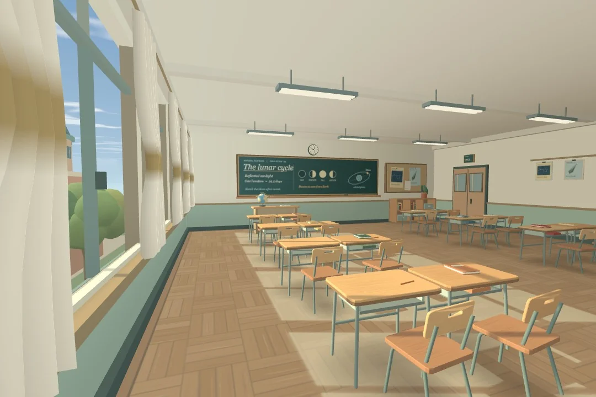
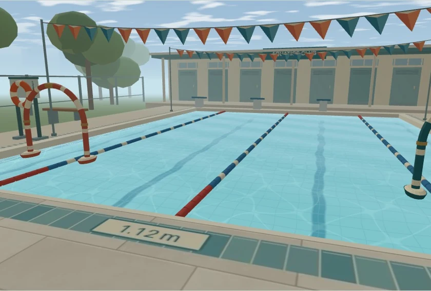
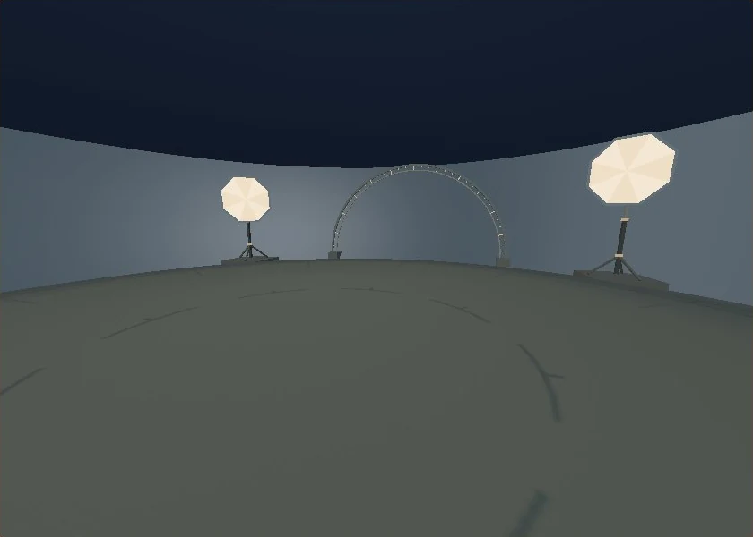
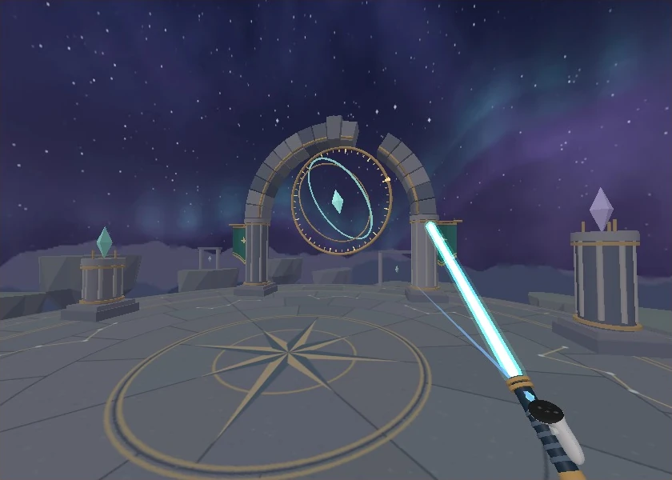
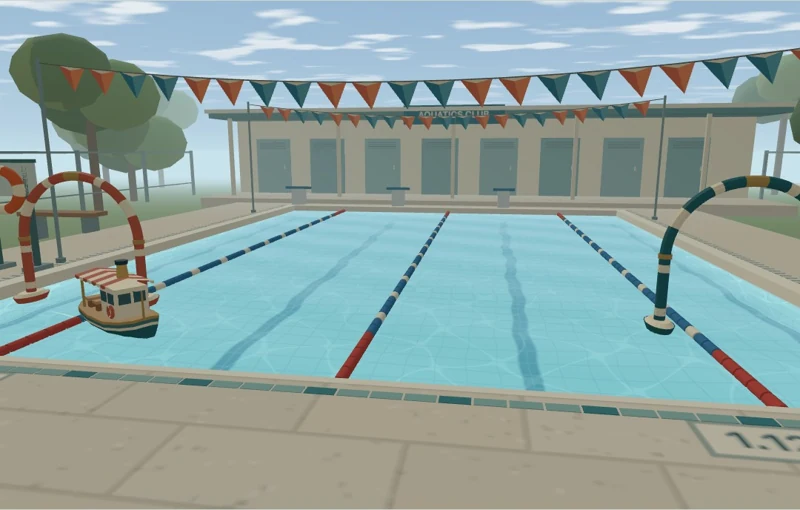

<div align="center">

# MMD XR Stage

**A standalone WebGL + WebXR MMD showcase built for Meta Quest.**

[](https://react.dev/)
[](https://threejs.org/)
[](https://immersiveweb.dev/)
[](./LICENSE)

[Live site](https://mmd-xr-stage.pages.dev) · [Documentation](./docs/README.md) · [Handoff](./docs/HANDOFF.md) · [Deployment notes](./docs/deployment.md)

</div>

Import PMX/PMD characters, VMD motions and GLB/glTF props on the prep page. Choose **Watch on screen** in a WebGL 2 browser or enter immersive VR on Quest. BGM playback is not implemented.

## Stage gallery



| Summer pool | Wisteria meadow |
| :---: | :---: |
|  |  |
| **Live House** | **Studio plinth** |
|  |  |

**Astral Court · the saber beneath the orrery**



**Dawn Chapel · the lily window above the sanctuary**


The four-set gallery and chapel are captured in screen mode. The classroom is the prep-page render; Astral Court is a desktop XR simulator capture. All show built-in scenery without imported characters. See [how the scenery is made](./docs/scenery-art.md) for the modelling and texture workflow.

## Features

### Three short scenes to play

| Kite stand | Bubble ferry | Encore print |
| :---: | :---: | :---: |
|  |  |  |

Fly a kite from a character's wrist in the meadow, send a bubble ferry through either pool gate, or print the club's curtain wings in your chosen order and hand over the encore mic. On screen, open the **Backpack** for the current set's cues; in VR, take its prop from **Backpack → Toys**. See the [scene and controller guide](./docs/vr-controls.md#三幕布景玩法).

### Prep Page

- Import folders, ZIP packages, or individual model, motion and scene files. Relative texture paths are preserved; missing resources and path conflicts appear in an import report.
- Imported files go into a same-tab backpack. Start on an empty stage, even without files, or continue the previous stage. Refreshing clears local files and layouts.
- Quest quality presets (safe / balanced / clarity) plus per-axis overrides: frame rate, framebuffer scale, foveation, antialias, shadows, DPR.
- Live XR readiness probe: secure context, `navigator.xr` availability, and an advisory `immersive-vr` support check, surfaced before you enter.

### In VR

For desktop and touch controls instead, see [Watching without a headset](./docs/screen-viewing.md). The same-tab backpack and scene layouts work in either mode.

- Choose a set from the viewing strip: the window-lit classroom, pool terrace, wisteria path, live venue, studio plinth, Astral Court or Dawn Chapel. See the [standing spots for each set](./docs/vr-controls.md#在布景中给角色选位置). Only the current room's instances are loaded; scenery does not consume character or object slots.
- Pick a character or prop from the backpack, aim at free ground, and release the trigger to place it. Select a placed character to move, turn, scale, change its motion, or put it away. Hidden items remain reachable from the backpack.
- Open Backpack → Toys for the current set's props. To [give a toy to a character](./docs/vr-controls.md#把道具递给角色), point at the character, press the trigger, choose **Give toy**, then pick its left or right hand. The prop follows the wrist during VMD playback. The Astral saber works in every set: squeeze the side grip once to extend it, again to retract it.
- Render diagnostics distinguish requested settings, session-reported refresh/layer properties, callback cadence, model-update CPU cost and renderer resource/draw counters. No GPU time is inferred from these values.
- After exiting VR, [export the last session's performance report](./docs/viewing-and-diagnostics.md) from the prep page before entering VR again or refreshing. It separates character placement and loader timings from frame intervals during viewing.
- In-headset HUD with quality controls, model transform, height adjustment, snap turning, and exposure/lighting looks.
- Meta Quest hand tracking with articulated hands, pinch-based HUD interaction, and hand-to-model physics collision.
- Optional controller collision, contact haptics, physics quality controls, and session-safe model disposal.
- WebXR MSAA on WebGL2 projection layers (Three.js r187, supported since r186) via the antialias quality axis.

## Stack

| Area | Technology |
| --- | --- |
| Application | React 19, TypeScript, Vite |
| 3D and XR | Three.js 0.187, React Three Fiber 9.8, React Three XR 6.6.32 |
| MMD | `@yohawing/three-mmd-loader@0.8.6` (patched), Bullet WASM |
| State | Zustand |
| Hosting | Cloudflare Pages |

## Quick Start

Requirements:

- Node.js `26.12.1` (Node 26; see `.node-version`)
- pnpm `11.20.0` (pinned in `packageManager`)

```sh
pnpm install --frozen-lockfile
pnpm dev
```

| Command | Purpose |
| --- | --- |
| `pnpm dev` | Start the Vite development server |
| `pnpm test` | Run the Vitest suite once |
| `pnpm build` | Type-check and create the production build |
| `pnpm deploy` | Build and deploy `dist` to Cloudflare Pages |

## WebXR Requirements

Production uses WebGL. WebGPU-in-WebXR now has browser and Three.js implementations, but this app has not migrated its session and MMD shader pipeline; see [the dated support investigation](./docs/webgpu-xr-status.md).

- Immersive VR requires a browser and device supporting WebXR `immersive-vr`.
- Production XR must run from a secure HTTPS origin; `localhost` is allowed during development. The prep page reports an insecure context or a missing WebXR runtime before you attempt to enter.
- Hand tracking is requested as an optional WebXR capability at session creation. Its availability depends on the headset and browser; the in-headset HUD can enable or disable its visuals, interaction, and physics collision.
- Controller collision and haptics were built and validated against the Meta Quest Browser; other headsets are untested.
- Desktop browser tests cannot replace headset validation. Regression items: model scaling, cloth fall/contact, panel persistence, controller and hand collisions, contact counts, and haptics.

## Local Data

Preferences are stored locally via `localStorage`. Imported files and the previous-stage snapshot stay in page memory and are cleared on refresh. ZIP imports support UTF-8 and optional Shift-JIS/GBK filename decoding; encrypted archives are not supported. See [asset import and stage resume](./docs/asset-workflow.md) for limits and recovery behavior. This repository ships no character or motion assets. Use only assets whose creator terms permit your intended use.

## Deployment

The production build is written to `dist` and deployed to the `mmd-xr-stage` Cloudflare Pages project (<https://mmd-xr-stage.pages.dev>) via `pnpm deploy`. See [docs/deployment.md](./docs/deployment.md) for deployment notes and wrangler caveats.

## Licensing

Licensed under the [Apache License 2.0](./LICENSE). Bullet runtime attribution lives in [docs/THIRD_PARTY_NOTICES.md](./docs/THIRD_PARTY_NOTICES.md).
