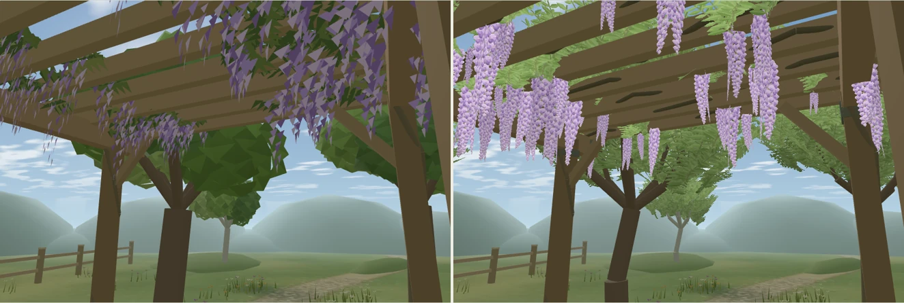

# 建模与布景

舞台有十景：[双喜堂](./wedding-court.md)从巷口花轿通到喜堂和侧室；[秦淮歌楼](./qinhuai.md)从埠头通戏台和二楼听曲廊。晴空草坪[连通门诊候诊厅](./clinic-garden.md)，也能去窗边教室和夏日泳池。另有 Live House、简易地台、星环遗庭和晨光礼拜堂。角色由用户导入。[实景截图](../../README.md#stage-gallery) · [各景站位](../gameplay/vr-controls.md#在布景中给角色选位置) · [接入新区域和通道](./adding-a-set.md)

## 布景怎么做

先读[整体美术方向与逐景材质优先级](./art-direction.md)。实际样板：[喜院门楼](./wedding-materials.md) · [窗边课桌](./classroom-materials.md)，含同机位前后、横移与实时阴影开关对照。

**场景人物是原来布景里的人员**，目前是医院诊室的护士。场内「环境 → 场景人物」只隐藏这类人员，教具、壁画和用户导入的角色保持原样。不为此向空场添加试镜人偶。[屏幕操作](../gameplay/screen-viewing.md) · [VR 环境设置](../gameplay/vr-controls.md)

本轮的[建模分工与贴图清单](./next-modeling-round.md)保留了喜院、校园与歌楼的设计意图。实际路线与机位见各景专页。

日景的云使用[按球面方向烘焙的无缝蒙版](../../scripts/bake-day-clouds.py)，太阳仍取各景主光方向。背景先绘制、不参与场景深度比较，按每眼朝向取景，移动玩家不平移云层。[草坪画面](../screenshots/day-sky-lawn.webp) · [泳池画面](../screenshots/day-sky-pool.webp)。两景切换的模拟双眼渲染已核对，真机观感待看。

### 妇科医院：一层楼、三个门洞

从候诊走廊走进诊室、手术室或女卫生间，不切场景，也不重新加载角色。建模、脚下可站立区域、摇杆行走边界和射线遮挡共用 `clinic/clinicLayout.ts`：通过门洞瞄准空地可以摆角色，墙后和隔间内部不能隔空摆放。屏幕的「游览机位」可将镜头放进每个房间。

[入口走廊](../screenshots/clinic-entrance.webp) · [诊室](../screenshots/clinic-exam.webp) · [手术室](../screenshots/clinic-or.webp) · [女卫生间](../screenshots/clinic-wc.webp)。八幅原创图包括妊娠三阶段、产检流程、超声、盆腔解剖、胎盘与脐带、手卫生、骨盆矢状面和产后照护。可选「解剖教具台」对着墙上的图观察立体模型，「妇产科器械盘」看四件器械，「卫生用品架」看用品和产后宣教。工作台的护士是静态环境模型。[教学陈列、实景与图文依据](./clinic-teaching.md)

### 校园连廊试点：连通两景，只运行一边

教室后门接有顶步道。窗外花架与草坪教学楼外立面复用各区原有实例批次；既有教室和草坪仍分别作为布局、玩法与报告的身份。`CampusLayout.ts` 描述同一段走廊的两套坐标；在门牌处定向跨界，再平移 XR 原点，不主动旋转头显。两向门线相距 0.95 米，避免刚到就反向触发。复用正常切景生命周期，先保存再卸载角色和 Bullet 世界。教室的地板、黑板和木纹改为[离线烘焙](../../scripts/bake-classroom-prints.html)，近门才提示浏览器取草坪图片。截图：[窗边](../screenshots/campus-window.webp) · [连廊](../screenshots/campus-hall.webp) · [回望](../screenshots/campus-school.webp)。[性能与验收](../performance/campus-passage.md)

### 第三区：从紫藤花架步行到夏日泳池

[泳池门廊](../screenshots/lido-garden-gate.webp)通向浅水端，沿右岸能走到远端[计时台与救生椅](../screenshots/lido-timing-deck.webp)。浅水端[回望草坪](../screenshots/lido-return.webp)时能看见回程门牌及花架轮廓。两区渲染同一段门廊，远区只有简模；只有进入泳池才挂载水面、渡船及计时秒针。看台、门柱、起跳台和水面占地与落点共用米制布局。溢水槽从 172 块小盒改为图集条，泳道号码、门牌、刻度盘、木板纹理和更衣室号码共用[原创图集](../../scripts/bake-lido-signs.py)。

### 晨光礼拜堂：从透光百合窗走到门外水庭

两侧十二扇尖窗、祭坛玫瑰窗和正门都在墙体留了洞口。玻璃按彩片明度透出庭院，深色铅条接近不透光，波纹和斜视高光按每只眼睛的视角计算。侧窗透光落在石砖上的图案由 [`paint-chapel.py`](../../scripts/paint-chapel.py) 沿本景主光方向采样同一份百合图离线烘焙。它固定在地面，不会投射到角色衣物上。

室内过道从 z=9 的门槛通向庭院尽头 z=33。池畔、薰衣草花坛之间及拱廊内可摆角色；柏树、石池和廊柱的占地由 `ChapelLayout.ts` 统一描述。远处山丘和陶瓦房用于取景。屏幕记录了四个游览机位；模拟 XR 用左摇杆出门，在 z=23.65 的池畔放置角色并验证切景恢复。玻璃近看与性能仍需实机确认。[百合窗](../screenshots/chapel-lily-glass.webp) · [水庭](../screenshots/chapel-water-court.webp) · [钟楼外观](../screenshots/chapel-bellcote.webp)

### 扩建尺度：在同一张地图里走到另一处取景

星环遗庭从直径 13.6 米的一座圆台扩为约 **58 × 53 米**的连通区域（平台外缘的包围尺寸，中间有虚空）。原点至北侧铜顶观星台中心 39 米；过主桥的十字岔口，向西是三幅季节星图的拱廊，向东是子午仪。桥面与三座露台和原庭等高，不占背包名额，共用本景布局。远处仅作背景的浮石不接受角色落点。[导览图](../screenshots/observatory-overview.webp) · [桥上回望](../screenshots/observatory-return.webp)。

区域位置、桥宽及设备占地在 `ObservatoryLayout.ts` 共用。桌面使用实际游览控件和鼠标在 z=-39.4 放置角色；模拟 XR 用左摇杆跨桥至 z=-36.6，扳机在 z=-39.2 放置，验证桥外拒放、切出时回到入口、切回后角色仍在远台。桌面默认画质空场五个机位 9–27 次绘制，远景的头显帧率待真机确认。

**先打磨角色身边现有的布景。** 取全身和一步之内的近景各一张，检查植物剪影、材料接缝、物体与地面的接触，而不只从远处看设施齐不齐。

### 草坪花架与遗庭拱门：同机位对照

两图均为屏幕模式实景，左旧右新；相同机位、光照、阴影关。草坪树冠和花穗共用一张 512×384 植物图，用裁去空白的折面做叶簇和总状花序。拱门、柱上珐琅刻度和曲面旗共用一张 1024² 图；金线与石缝画在图里，布褶和柱棱仍是立体轮廓。[离线制作脚本](../../scripts/paint-grove-court.py)。

花径／架下两个空场机位，绘制调用都是 8，三角形从 66,731 到 53,838；遗庭正面 16 次、柱旁 15 次，不变，正面三角形从 15,336 到 16,888。带透明裁切的叶簇仍有像素开销，需在头显确认远处叶缘是否闪烁。这里的计数不表示 Quest 帧率，也不衡量 VMD 播放。

### 制作方法

看礼拜堂的侧窗最容易分清：玻璃里的百合花瓣和铅条是图，前面的石边框、窗台、束柱是立体模型。头往旁边移时，近处石框会遮住一部分花瓣。让这个遮挡和轮廓正确，比把所有纹样都堆成小网格更重要。

- **先定尺度和机位。** 舞台以米为单位，角色脚底是 `y=0`。椅子、柱脚等从布局数据确定外形和占地。用眼睛实际能走到的位置决定要做哪些面。
- **建会改变轮廓的部件。** Three.js 组装木条、支架、鼓圈和软箱格栅。大量同种部件放进 `SceneryBatch.tsx` 的实例批次里。花穗等非规则形状用少量带顶点颜色的三角形拼成。
- **把表面细节提前画好。** [`paint-chapel.py`](../../scripts/paint-chapel.py) 用 Pillow 和 NumPy 生成玫瑰窗、百合侧窗、石墙和地砖。四个旧景用 [`paint-close-surfaces.py`](../../scripts/paint-close-surfaces.py) 生成池岸拼花、径上碎石、长椅木纹与铭牌、舞台木地板和摄影台刻度。草坪底图最初来自 [`bake-meadow.ts`](../../scripts/bake-meadow.ts)。成品 WebP 随布景按需加载；Python 只在制作时运行。
- **看第一次进场的材质。** 如果标准材质先以 `map=null` 编译，贴图到达时要重建带 `USE_MAP` 的材质（或显式请求重编译）。网络请求成功、编译无报错都不能证明图案已经出现在表面。喜院用小色板保住首帧朱红和木色，分别放行建筑和陈设 WebP，再用同机位检查匾字、轿帘织锦和切景回访。
- **把会随视点变化的效果留给实时渲染。** 泳池水面用着色器按每只眼睛的视线折射到池壁或池底，再叠加波纹、水下釉带与高光。地面上的接触阴影则可以提前画进贴图。

重做后用同一机位、同一灯光和关闭实时阴影的画面比较。四景精修时每景拍了两处：池岸和伞下、花径和长椅、舞台和鼓组、地台和灯架。若再精修，先在头显中找会遮挡角色、出现锯齿或贴图模糊的具体机位；修改后也要验证道具演出和[落点规则](../../src/mmdVrShowcase/scenery/placementAreas.ts)。桌面渲染计数适合比较几何改动；判断持续帧率仍需[头显实测](../performance/viewing-and-diagnostics.md)。
