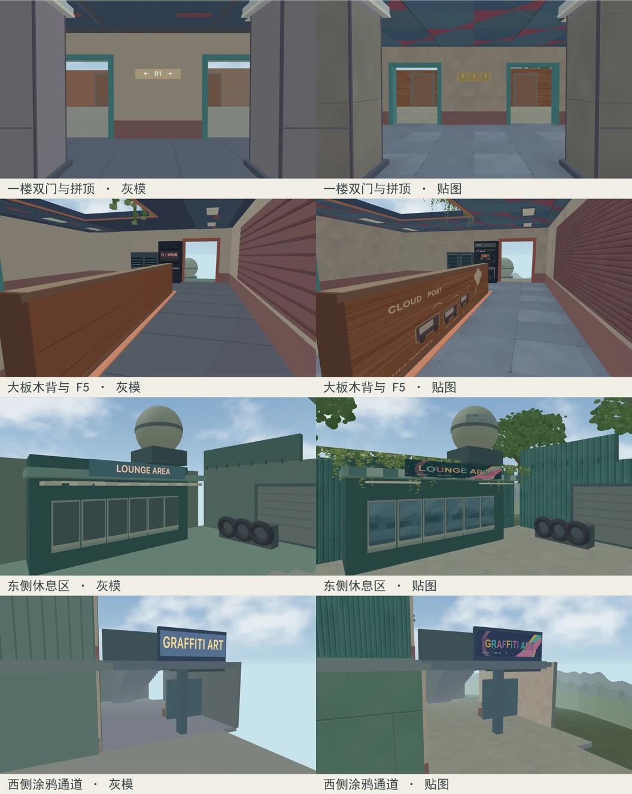
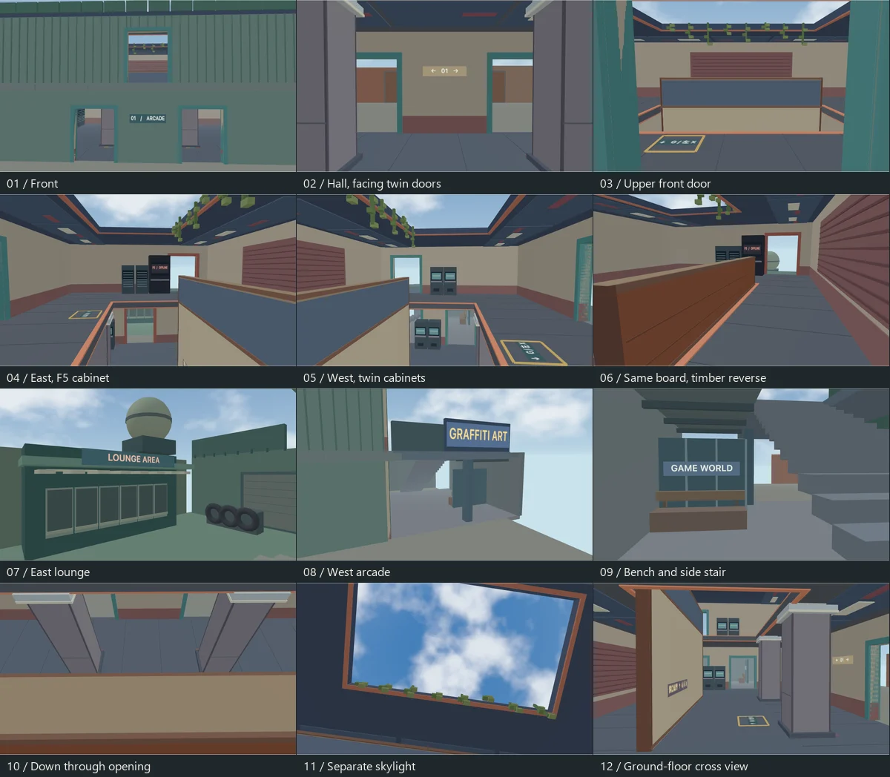

# 电玩厅出生点｜双层场景与首轮贴图

**本地预览：[直接进入电玩厅](http://127.0.0.1:5837/?preview=arcade)**。若服务已停，在 `E:/WebProjects/mmd-xr-stage-arcade` 运行 `pnpm build`，再运行 `pnpm preview --host 127.0.0.1 --port 5837 --strictPort`。普通 `/` 入口可先导入文件；在「观看环境」选「电玩厅出生点」，再进屏幕或 VR。同一页中切景可恢复角色与物件；刷新会清空页面背包。此版仅在 `prototype/arcade-block`，没有线上地址。

## 在原机位看贴图

先从「二楼 · 从正门看大板」看拼顶、天窗藤叶和板的搪瓷面，再到「近看 · 木板喷绘」看同一块板的木背。西端两台街机有不同的原创赛车画面；「近看 · 双机台面」能辨出按键和投币口。东侧的条纹雨棚与橱窗玻璃、西侧上下层的 GRAFFITI ART／GAME WORLD 灯牌是各自的认路标记。

**正面剖面（按用户补充校正）：** 二楼单门前有从东到西连续的露天平台，主厅正面段长约 14 米、从上层外墙饰面到外沿净宽约 2 米。**一楼双门外墙与平台外沿齐平**，平台底下是加深后的一楼大厅。右侧涂鸦牌下另有露天通道；不能把两处都做成悬挑。选「二楼 · 沿正门平台望西」可顺着长边看两个方向的连接。

[正面和平台纵向的两个实际机位](./arcade-front-walk.webp)。双眼模拟 Quest 已从一楼双门进入、通过洞口到上层、穿过单门，沿平台从东端走到西端再返回。两端眼高同为 5.05 m；回到一楼为 1.65 m。四张贴图合计约 477 KiB，准备页不请求它们。正式构建的 17 个本地机位已检查，实际材质 WebGL 编译与链接通过；三轮回访在同机位均为 7 次绘制、7,880 个三角形。本机模拟结果不代表 Quest 真机帧率。

[烘焙脚本](../../src/mmdVrShowcase/scenery/arcade/bakePrints.py)只读随机种子、绘图参数及系统字体，生成四张 WebP：八类建筑表面、打包法线／粗糙度、文字和机台图集、带透明边的藤叶／远景。用 Pillow、NumPy 可重画，不依赖原作截图。`paintedShell.ts` 沿米制网格裁切表面，洞沿、天窗和门洞仍是开口；装饰绘制和行走实体分别处理。远处树冠与街影只是借景。楼层高、门宽仍是按图估算，贴图通过不代表已完成尺寸校准。

## 先试这个洞

- **屏幕：** 选「游览机位 → 一楼 · 洞口通行标记」，点一下画面，按 **G**。在二楼的黄框里再按 G 下去。也可从正门走进来：WASD 平移，Q/E 转头。拖动、滚轮和 F/C 用于自由查模；导览不算步行。可选「二楼 · 从洞边俯看」检查橙沿以内确实露出下一层。
- **Quest 控制器：** 普通模式下，从任一青框门进同一个大厅，绕过方柱，到大板蓝灰面前的地面黄框。用左摇杆站进框，按一次**左手 X**。抵达橙沿前方，面向不变；在上框再按一次 X 返回。上层也能直接从洞内落下。A 仍是普通跳跃。
- 这是灰模的**两点通行操作**。上行先在净空内竖直核查身体，再沿板边上方核查到落点；下行反向。若通道中或落点已有实体挡住身体，不执行。黄框不是传送到另一张地图，不借外梯；没有据此推断原作使用哪个按键或动作。

## 按截图方位找结构

从正面朝大厅看，**左为东侧休息区，右为西侧涂鸦通道**。以下是参考图的本机文件名；仓内没有原截图或其裁图。尺寸均为方便行走和比对的初值。

| 本机参考（`.png`） | 灰模里核对什么 |
| --- | --- |
| 出生点正门、出生点二楼正门、一楼内部正面视角 | 正面双青框门、两根方柱与同一间大厅；二楼单门和前平台。从二楼门看见板的蓝灰面。 |
| 一楼大洞、二楼大洞、一楼穿过大洞看天花板 | 橙沿开口的净跨度约 6.90 × 3.26 m。大板脚在一楼、顶高出二楼约 1.22 m。穿过楼板洞还能看见**另一个**上方天窗和垂藤；天窗采用不同大小和偏心位置。 |
| 出生点一楼东方向、出生点一楼西方向、一楼西门 | 一楼横看：方柱、板脚、机器和侧门各自遮挡。门外可进入西侧有顶的下通道。 |
| 二楼东方向、二楼西方向、出生点东方向、出生点西方向 | 绕洞看到东端 F5 故障柜、西端并列双机；绕到板后是木面与卷帘。没有叠两块互不相干的看板。 |
| 出生点东侧整体、出生点东侧门外 | 下沉休息区、条纹篷、LOUNGE AREA、球罐、轮胎和下台阶；从外平台可俯看。 |
| 出生点西侧整体、出生点西侧门外 | GRAFFITI ART 在上层通道边，下层是柱廊、GAME WORLD 长凳、玻璃色块与侧梯。与东侧不是镜像。 |

上层室内初始占地约 14 × 9 m，一楼向外加深到约 11 m；楼层差 3.40 m。外侧台阶长度、门净宽、各机位的精确视场、截图边缘外的墙体，以及本作实际通行输入都未测绘。边界处只补用于读方向的体量，不延伸成整张地图。

## 放置为什么不会跳层

[布局](../../src/mmdVrShowcase/scenery/arcade/arcadeLayout.ts)把楼板拆成围洞的四块实体。玩家按当前脚高查询真实几何；背包只拾取有尺寸的支撑面，并把**该平面的世界 Y** 连同 XZ 送到命令。提交前重验支撑和脚边净空；瞄准时按三维线段检查墙、板、台阶和设施。新放、移动用同一路径；回访从已有三维布局重建。其他布景保留原有高度规则。

## 本地实测（2026-11-21）

- **屏幕 WebGL / Edge：** 已逐个进入 14 个游览机位；上图取自实际舞台。G 往返时相机从 `(-1.35, 1.65, 0.68)` 到 `(-1.35, 5.05, 2.08)` 再返回。实际按键移动、转头、滚轮缩放、鼠标拖动后可重置到正面。在上层用鼠标放下测试 GLB，读取实际节点为 `(1.42, 3.40, 2.35)`。检查了正在使用的 WebGL 程序的链接状态和着色器编译状态。
- **模拟 Quest 3 / IWER：** 两个正门分别实走；左摇杆走到洞下，左 X 上行，贴橙边横移约 2.5 m 时眼高保持 5.05 m，再左 X 回到 1.65 m。另走东侧台阶到下沉休息区，眼高 0.97 m；经西侧下通道到侧梯，用同一左杆走上外平台，穿过二楼单门，眼高回到 5.05 m。未用自由飞行完成这些路线。
- **模拟右扳机：** 射线穿大板或擦穿楼板端面时仍处于待放状态；无遮挡地穿过洞口则能把合成 PMX 实放在 `(1.05, 0, 0.29)`。另一测试 GLB 先放在 `(0.65, 0, 2.83)`，再移到同一 XZ 的 `(0.65, 3.40, 2.83)`。切去简易地台后本景实例清空，再回来两件资产都恢复在原先的三维坐标。菜单回场时玩家回正门，而不是跟随恢复的物件上楼。
- **验证界限：** 未在物理 Quest 3S 上判断尺寸感、X 键的近眼提示可读性、舒适度或帧率。预览只监听本机回环地址；头显不直接访问电脑的 `127.0.0.1`。测试用开发服务 5836 已关闭，供比对的本地构建预览使用 5837。
- **工程检查：** Node 26.12.1；`pnpm exec tsc -b --pretty false`、`pnpm build`、`pnpm test --maxWorkers=2`（93 个文件、401 项）通过。高并发首轮曾有测试 worker 启动超时；未调高用例超时或跳过用例。
