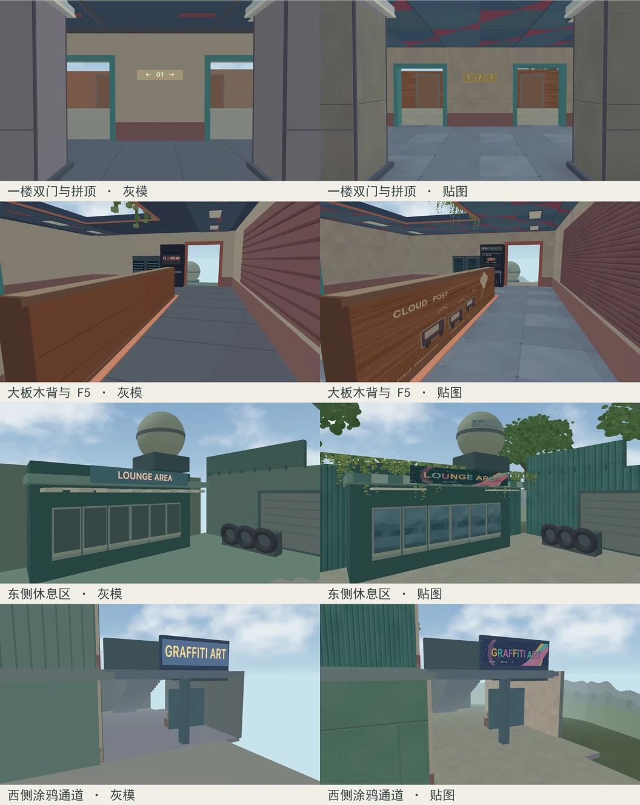

# 电玩厅出生点

[直接在屏幕中逛电玩厅](https://mmd-xr-stage.pages.dev/?set=arcadeHall&view=screen) · [先导入模型或进入 VR](https://mmd-xr-stage.pages.dev/?set=arcadeHall)

一楼的两个青框门通往同一间大厅。大板从一楼立起，蓝灰色正面伸出二楼，背面是木纹喷绘。它旁边的橙沿长方洞连接两层；从一楼仰看，还能透过另一个天窗看到垂藤和天空。

## 怎么走、怎么摆

- **从洞口换层**：屏幕选「游览机位 → 一楼 · 洞口通行标记」，点一下画面，按 **G**；VR 普通模式用左杆走进板旁黄框，按**左手 X**。再按一次可从上层黄框下去。出口或路径被挡住时不能换层。右手 A 仍是普通跳跃。
- **沿外侧往返**：面对正门，左边是带条纹雨棚和球罐的东侧休息区，右边是涂鸦招牌、玻璃廊和西侧外梯。从外梯上楼可一路横走到东端。二楼正门前平台净宽约 **2 米**，一楼双门外墙与平台外沿齐平，平台下方也是大厅。[正面与平台纵向实景](./arcade-front-walk.webp)
- **摆放角色**：从背包选择角色或物件，指向你实际看得见的地面，点击或松开扳机。上下层可以在相同平面坐标各放一件，不能隔着楼板或大板摆放。透过洞口能指到楼下。切景回来仍在原楼层。
- **近看贴图**：19 个机位中，「近看 · 双机台面」看赛车屏和投币口，「近看 · 木板喷绘」看板背，「二楼 · 沿正门平台望西」看平台两端。「仰看 · 穿洞见天窗」适合检查上、下两个开口。

## 从西廊步行上楼

西廊门外现接[校园步行街](./campus-arcade-loop.md)；从草坪能走到涂鸦牌下，再从二楼东侧平台沿缓坡前往泳池计时台。这些街段是舞台原创，原截图中的电玩厅出生点仍是中心区块。

选「西廊 · 从涂鸦牌下进门」，沿 **GRAFFITI ART** 下方的红框向里走，右手是长凳。到梯背的 **← HALL** 牌，往左侧门可以回大厅；沿楼梯侧壁一直走到尽头，绕过梯脚，另一侧就是蓝灰色橱窗。橱窗前有给角色留的站位，可以把陈列架和外梯同时拍进画面。从这里回头走外梯，不用按换层键就能上二楼正门平台。

「西廊 · 从橱窗回望外梯」从另一端看同一段路。[牌下入口和橱窗梯脚实景](./arcade-west-walk.webp)。红框、顶灯、靠墙长凳和梯旁玻璃廊按西侧截图取景；橱窗里的小机盒、印刷招牌和导向图案为本舞台原创。

## 布景维护

[布局](../../src/mmdVrShowcase/scenery/arcade/arcadeLayout.ts)是楼板、门、阶梯、碰撞和放置的坐标来源。上层室内约 14 × 9 米，一楼约 14 × 11 米；楼面 `Y=3.40 m`。尺寸是本舞台取景和通行用的近似值。板脚、楼板洞和屋顶天窗分别建模，不能为简化拾取盖上一个穿过洞的整面。

背包记录射线命中的支撑面高度 `supportY`，松开时和房间提交前都重验。[摆位](../../src/mmdVrShowcase/scenery/arcade/arcadePlacement.ts)从布局生成射线平面，检查脚边余量和遮挡；[通行](../../src/mmdVrShowcase/scenery/arcade/arcadeTravel.ts)管脚下支撑范围和穿洞路径，由屏幕和 XR 共用。换层不卸载演员。[维护指南](./adding-a-set.md)

[烘焙脚本](../../src/mmdVrShowcase/scenery/arcade/bakePrints.py)用 Pillow、NumPy 和系统字体重画四张 WebP，合计约 483 KiB，进入本景才请求。[表面网格](../../src/mmdVrShowcase/scenery/arcade/paintedShell.ts)按米制网格裁砖，不跨门洞。[西廊构件](../../src/mmdVrShowcase/scenery/arcade/westGallery.ts)区分占地实体与小配件，灯片、包装和玻璃共用现有图集和绘制批次。仓库中的[早期布局图](./arcade-blockout-views.webp)、各版机位和平台图均取自舞台自身。

**验证范围**：屏幕实点与模拟 Quest 扳机检查同一 XZ 换层放置、穿板拒绝及回场恢复；摇杆实走门前平台东西往返，地面／二楼眼高为 1.65／5.05 米。已检查 WebGL 着色器；Quest 3S 真机的尺寸感、舒适度和帧率还需实测。
