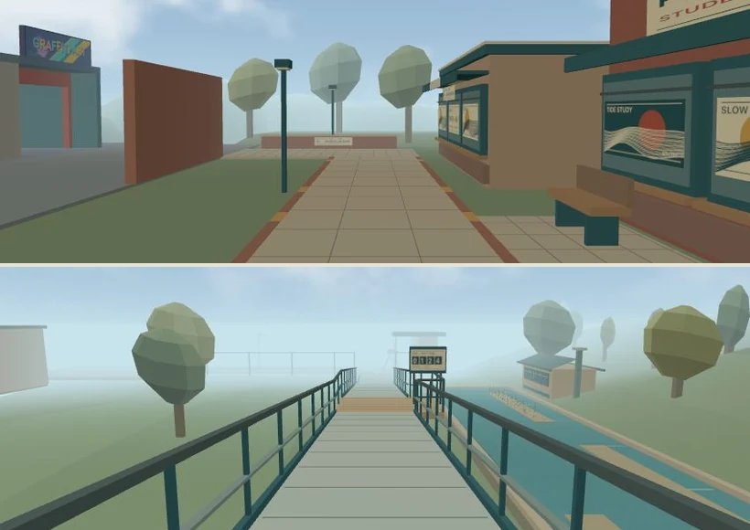

# 校园版画街与泳池计时步道

从草坪花径往东，有一条铺砖街经过学生版画工坊。走到尽头，在矮墙的箭头处左转，穿过 **GRAFFITI ART** 招牌下方的红框，就是电玩厅一楼西廊。工坊窗前的加宽小院可以摆角色，长凳和橱窗不会接受落点。

**从电玩厅去泳池：** 沿西廊内侧走到梯脚，折回上楼，横穿二楼正门平台到 LOUNGE 一端，再沿侧阳台走到背面。坡道逐段降到泳池东侧的干地；转角平台适合把角色与下方芦苇净水池一起取景。抵达计时区后，椅子左边是能摆角色的站位。沿泳池东边步道走回售票入口，即可回到草坪。行走和屏幕导览都可以反向通过这些开口。

## 维护与测量

- [布局](../../src/mmdVrShowcase/scenery/routes/campusArcade/site.ts)统一使用草坪米制坐标：电玩厅原点 `(39, −15.4)`，泳池原点沿用 [`POOL_ORIGIN`](../../src/mmdVrShowcase/scenery/LidoLayout.ts) 的 `(−11.4, −20.3)`。两条新门线都落在 `Y=0`，正反方向错开；绕完整圈平移相消。
- 坡道从电玩厅东廊背面 `(-7.85, −4.45; Y=3.40)` 接出。转角 `(-7.85, −24.15; Y=2.05)` 和中间休息平台 `(-22.3, −24.15; Y=1.08)` 有独立水平拾取面。中间坡面由实体斜板提供连续走高，不把角色吸到一张虚构的水平面上。
- 泳池本地 `(10.5, −19.25)` 处是围栏的真实开口。从这里沿地砖到 `(5.8, −20.42)` 可以看见计时钟、裁判椅和泳道。街面一直回接电玩厅牌下的真实地台；草坪 `36 m` 拾取范围之外才补地面射线，避免重叠事件面。
- [通行及射线测试](../../src/mmdVrShowcase/scenery/routes/campusArcade/layout.test.ts)让普通身高的碰撞柱双向走过红框、外梯、上层楼板、三级坡段和泳池围栏。另测闭环平移、落点、长凳遮挡、细钢架空隙、植物让路。岸坡、净水池、远景建筑不参与人物支撑。
