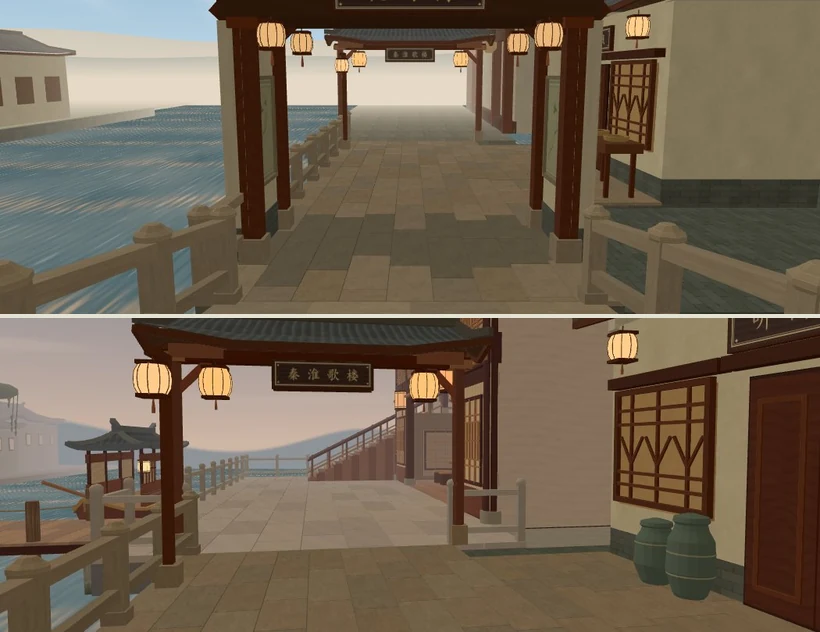

# 从喜轿巷到秦淮歌楼：枕河街

在喜院门外沿轿杠**后端**绕到西头。蓝印花布晾在水巷边，再往前是听潮桥：走上石坡，桥心是一片水平的双人留影地；两道栏杆外都是真水。桥西下坡后，穿过写有「枕河街」的小瓦门，光线由日景转入秦淮暮色。听雨茶栈和临水石栏分在街道两侧，尽头的漆木牌额「秦淮歌楼」标出歌楼东栏的开口：从这里上原有码头，不用登船或绕二楼。反向走时，茶栈收在身后，桥面、蓝布和旧喜门依次出现。

## 路线与摆位（米，XZ）

- **喜院出生 → 歌楼**：`(.65,10.15) → (.3,11.4) → (-5.8,11.4) → (-10.4,10.45) → (-17,10.45) → (-24,10.45)`。不要从原喜轿中间横穿。桥心 `(-17,10.90)` 实际高度 **0.42**；桥面两个坡段只供行走。南栏外 `(-17,13.4)` 不能摆人。
- **歌楼出生 → 喜院**：`(.2,9.1) → (4.8,7.65) → (7.5,7.65) → (11.6,7.65) → (17.8,7.65)`。茶栈前岸上 `(11.6,8.10)` 实际高度 **0**；临水一侧 `(11.6,10.80)` 和茶案 `(13.92,4.22)` 不能摆人。
- 屏幕原地查看可选「石桥上 · 望向秦淮」与「河街埠头 · 回望喜院」；「沿河街 → 秦淮歌楼」「过石桥 → 双喜堂」则是跨区机位。沿街走过门线使用平移，不重置玩家朝向。

## 如何维护

[`plan.ts`](../../src/mmdVrShowcase/scenery/routes/riverStreet/plan.ts) 用喜院坐标画一张图。歌楼坐标为 `(x+40,z−2.8)`。石桥两侧石坡、4 米平顶、铺岸、茶案、晒布、门柱、栏段都是渲染和判定的尺寸来源。原喜院西头的借景房已迁开，地平板在支流处切开；歌楼的东石栏则切实分成两段。两侧都用同一段瓦门与平坦地面，在门下错开 0.48 米切换；叠接区跨过两条门线。门内、坡面和岸外不能放置。支流承托的是桥体，不是水面。

[`layout.ts`](../../src/mmdVrShowcase/scenery/routes/riverStreet/layout.ts) 保留原场景规则，仅接管新街面及旧地面边缘的一小条开口。喜院给桥冠单独登记 **Y=.42** 的拾取面；其余新落点均在公共平面内。视线按三维有限线段查栏杆空隙、柱、茶案、实际桥面和门楣，同时仍需通过当前房间原有的遮挡检查。新街对面的歌楼／喜门只做有厚度的远景轮廓，不加载另一套室内陈设或演员。

临水窗、瓦顶与楔形桥券用共享砖石图集；鱼纹蓝布、枕河街木匾用[本街原创印版](../../src/mmdVrShowcase/scenery/routes/riverStreet/bakePrints.py)烘焙，不在帧内绘字、更新水面或开额外灯光。变更桥宽、栏杆或茶案，请复查[双向脚位、真实拾取面和桥栏视线](../../src/mmdVrShowcase/scenery/routes/riverStreet/riverStreet.test.ts)。
