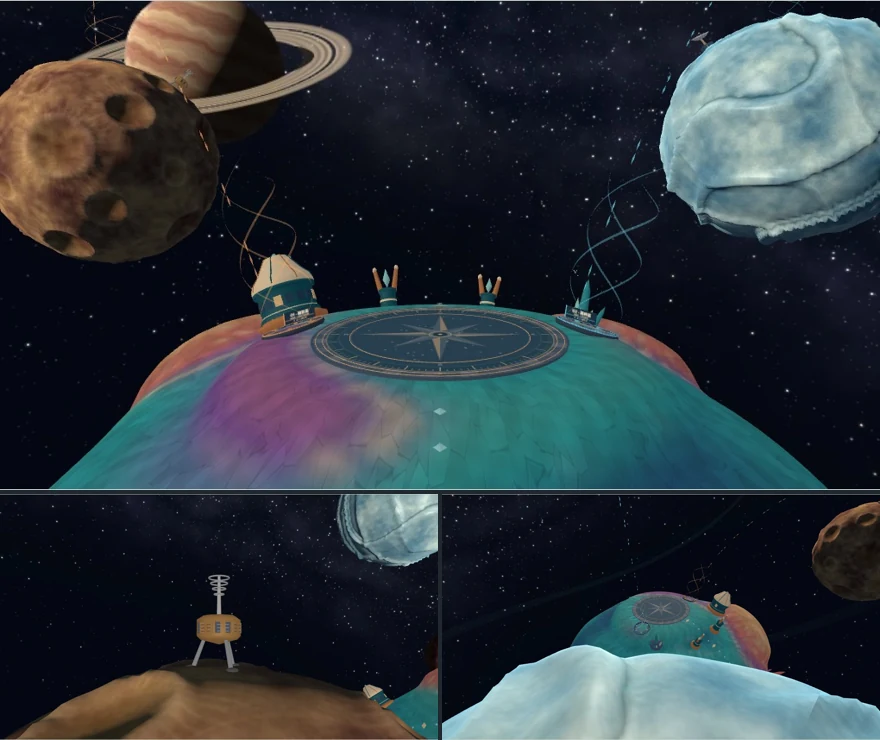
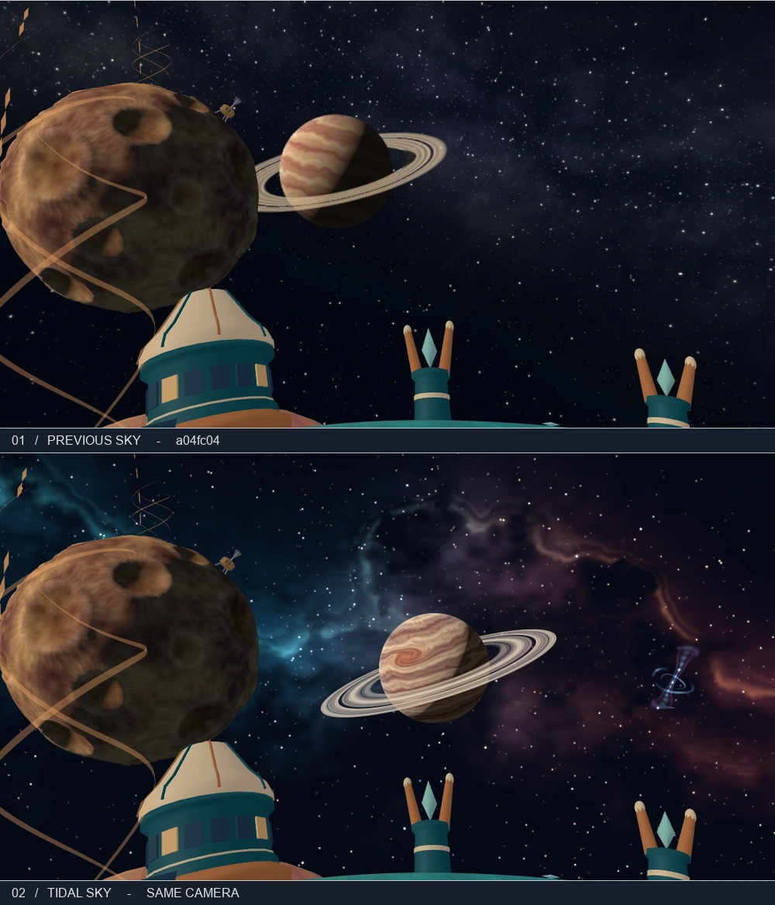

# 琉璃小行星

从场景菜单选「琉璃小行星」。从罗盘地台出发，沿金色子午线穿过两根测星柱，走过青绿矿脊和撞击盆地，球背有一座带光环的信标。普通模式左摇杆行走，右手 A 低重力跳跃，右摇杆横拨转向。初次建议慢走或常速，绕行时地平线会随脚下方向改变。

角色和导入物件可放在北端直径 5.6 米的平坦观星台，玩家能绕行全球。金属罗盘和刻度是平面的，地台外的山脊则有真实起伏。屏幕「游览机位」可看环行星、铜穹观测站和南极信标；后两处按当地地面设定镜头上方，仍可拖动、滚轮缩放、WASD 平移、Q/E 原地转头。R 回到北端入口。

## 从罗盘起飞：两条往返风道

[先导入角色／进 VR](https://mmd-xr-stage.pages.dev/?set=glassPlanet) · [屏幕直接进星系](https://mmd-xr-stage.pages.dev/?set=glassPlanet&view=screen)

从出生点面对两根测星柱，走到罗盘**左前方的琥珀环**或**右前方的冰蓝环**。普通模式站进环内，按一次**左手 X**。风道先抬升，再沿弧线越过母星边缘，在目标星球的返航环落地。全程连续移动，不替头显转头。站在环外按 X 不会起飞；在地面右手 A 仍是跳跃。

- **赭砾星**：约 8.5 秒抵达。赤褐色坑底、明亮坑缘和喷出纹围着三脚测震仪展开。用左杆绕过测震仪，能走向球背；回到写有「返航 · 琉璃星」的环内按 X 回家。
- **霜岬星**：约 9.5 秒抵达。沿冰蓝裂带、浅色压力脊，走到地平线上的接收天线。这里沿自身球面的法线行走、转向和跳跃，返航操作相同。
- **屏幕**：选「游览机位 → 起飞风道 · 赭砾星／霜岬星」，点回画面按 **G**。到站镜头会转向当地仪器；在原落点再按 **G** 就能返回。若用鼠标离开了环，可选对应的「回望母星」机位。**R** 结束当前镜头行程并回入口。

三颗近星属于同一活动布景，演员始终在母星北台。地面与风口使用舞台米制；更远的天体用于取景，按双眼位置独立投影，没有可以落脚的地表。尺度和飞行时间为观看、行走而缩小，不模拟真实天体轨道。

**维护与验收**：[目的地、测站与航线](../../src/mmdVrShowcase/scenery/planet/windAtlas.ts)供渲染和移动共用；[径向地形与网格](../../src/mmdVrShowcase/scenery/planet/moonSurface.ts)共用同一高度函数。[卫星行走](../../src/mmdVrShowcase/movement/moonWalk.ts)只更新玩家。飞行与卫星行走期间暂停母星的 Ecctrl 驱动，返航再从实际落点交还。两种地貌使用[原创反照率贴图](../../src/mmdVrShowcase/scenery/planet/bakeSatellites.py)。[检查](../../src/mmdVrShowcase/scenery/planet/windAtlas.test.ts)覆盖带偏移起飞、往返曲线净空、球背移动、地表射线和穿星拒放。诊断另记 `windDepartures` 和 `windLandings`。两条路线都已用屏幕 G 和模拟双眼 Quest 左手 X 往返；阻断可选物理模块时另验赭砾星起降、行走和跳跃。实机舒适度和帧率仍待 Quest 3S 检查。

## 深空 · 潮汐星云与脉冲星

选「观星台望行星环」，看琥珀色行星的大气涡旋、环缝和环背后的阴影。保持朝向用 A／D 横移，行星、暗尘和远处的星点会分别错开；也可以沿风道升空再回望。第二个观测方向是「**深空 · 脉冲星双向喷流**」：蓝白核心的两边各有一束弯曲喷流，亮结缓慢向外走，赤道附近是两段断续的弧光。

[脉冲星喷流与赤道弧光机位实景](../screenshots/planet-pulsar.webp)。

- **星点**：[星表](../../src/mmdVrShowcase/scenery/planet/sky/StarCatalogue.tsx)有 8,831 颗，位置、亮度和色温固定，一次绘制。星芯按每眼视口的像素宽度过滤；远星基本不动，较近的星群有视差。穿过前方尘带的星光会减弱。
- **云气**：[潮汐星云](../../src/mmdVrShowcase/scenery/planet/sky/TidalNebula.tsx)分别采样后方发光云壳和前方吸收尘埃；[烘焙源](../../src/mmdVrShowcase/scenery/planet/sky/bakeSkyFields.py)只生成密度、亮丝和风暴云带数据。星点、行星和环都单独绘制。
- **天体**：[远行星](../../src/mmdVrShowcase/scenery/planet/sky/DistantSystem.tsx)按当前眼睛的视线求与球面、环面的交点，实时判定环的前后遮挡、环影和行星本影。四个远月共用一批；[双向喷流](../../src/mmdVrShowcase/scenery/planet/sky/Pulsar.tsx)用带深度的曲线。天空在场景实体前先绘制，前景演员和近星自然遮住它。自由飞行的远景视差有上限，不会飞出天空。

**验证范围**：在相同的 1,100 × 606 WebGL 画面里，固定时间、朝向，仅平移眼睛 6 米。旧版 `a04fc04` 单独渲染的天空完全相同，新版环行星亮部形心横移约 27 像素。单独渲染天空为 5 次绘制。另取五档亮度、连续 18 个亚像素转头位置，在每颗星周围 14 × 14 像素内积分，检查不掉点；逐项核对实际着色器的编译、链接及双眼视口。这些是桌面 WebGL／模拟 XR 的结果，Quest 3S 的锐度、闪烁和帧率以实机为准。

### 早期地形与天空记录

[北端罗盘与环行星](../screenshots/opal-compass.webp) · [南极信标与远月](../screenshots/opal-south.webp)（正式构建的屏幕机位）

- [径向地形](../../src/mmdVrShowcase/scenery/planet/opalTerrain.ts)用同一高度函数生成球壳、Rapier 三角面及加载前的贴地支撑。240 个方向的测试将数学半径与渲染网格的实际射线交点对照，允许误差 3.5 cm。建筑、晶簇不占用北端双人站位；瞄准观星台时会拒绝穿过山脊或仪器的射线。
- 早期天空由 [`bakeFirmament.py`](../../src/mmdVrShowcase/scenery/planet/bakeFirmament.py) 将恒星、尘带和五个远天体合成全景图，仅随眼睛朝向旋转；这是上方同机位对照的旧版。母星地面的罗盘和矿纹仍使用 [`bakeLanding.py`](../../src/mmdVrShowcase/scenery/planet/bakeLanding.py)。
- 三轮屏幕实景修订：先对照旧版测山形和天空；再纠正环行星被初始镜头裁切、地台缺少比例参照的问题；最后把侧面／南极机位改为局部水平，修补迟到贴图并对行星环离线抗锯齿。双眼模拟 Quest 用实际摇杆沿子午线走到球背，沿线采样地形高差约 1.18 m；正常载入与阻断物理模块各走一遍，均可原地跳起、落地、转向 30°、按 B 召回。测试不等于 Quest 3S 真机帧率或舒适度。

[球面移动](../../src/mmdVrShowcase/movement/PlanetMotor.tsx)从第一帧就读取当前会话的手柄，Quest 使用原生 `xr-standard` 摇杆轴 2/3；其他布局可使用当前输入源的已解析摇杆。物理模块还在下载、编译或启动失败时，沿球面和平台走、转、跳、召回和飞行仍可使用。[Ecctrl/Rapier](../../src/mmdVrShowcase/movement/PlanetPhysics.tsx)就绪后从当前脚位、切面朝向、速度接手；不会把玩家送回观星台。两种路径共用 XR 原点和转向锁存，2.5 m/s² 的径向重力不进入角色 Bullet 世界。

仅在 XR 进入本景时加载 Rapier（同源 JS 内联 WASM，本次约 1.60 MB gzip）；静态入口不能依赖它，由 Vite 构建检查。Ecctrl 每个渲染帧施加一次冲量，给它过长的物理步长会放大支撑弹簧，故每帧最多推进 1/60 秒。落点射线只接受北端平台；普通移动对导入物件使用实际三角面，对角色使用躯干代理。

**真机已知现象**：2026-11-20 14:43Z 的 Quest 3S 报告记录了两次空景访问、21 个采样窗，FPS 中位数 117。用户确认 B 可用、左右摇杆都不能移动或转向。旧报告没有摇杆、姿态或玩家物理状态，不能据此定位为 WASM、追踪或手柄配置故障。

**验证**：双眼模拟 Quest 的生产构建中，刻意挂起 1,569,397 字节的 Rapier WASM 实例化，左右摇杆仍可行走与 30° 转向；放行的那一帧视点位移和转角均为零。另一次直接拒绝实例化，走、转以及离开后再回来仍有效。另用模拟手柄走至球背（局部向上轴的世界 Y = −0.9996），转向 30°、按 A 径向升高 0.247 米、落回原高度，并用 B 召回后点开「更多」。此前的[球面探针](../../experiments/three-planet-wheel/README.md)在 72/90 步下走过整周。桌面模拟不证明真机原因已排除或头显舒适度合格。

**真机复测**：新开页面进空星球，左摇杆向前 2 秒，右摇杆横拨、松开再横拨，按 A 跳和 B 召回。切到平地再进星球重复，退出并导出 JSON。`windows[].planetMovement` 是本次进星球以来的累计记录：`backend` 为 `pending` / `rapier` / `failed`；`poseFrames` 对照 `frames`，`left/right` 表示输入来源，`walkInputFrames`、`turnInputFrames` 为检测到摇杆的帧数，`inputHeldFrames` 为界面拖动或退出锁住输入的帧数。`snapTurns` 和 `footTravelM`（包括升降、跳跃及物理位移）记录实际执行结果。只保存计数和距离，不导出追踪坐标。
