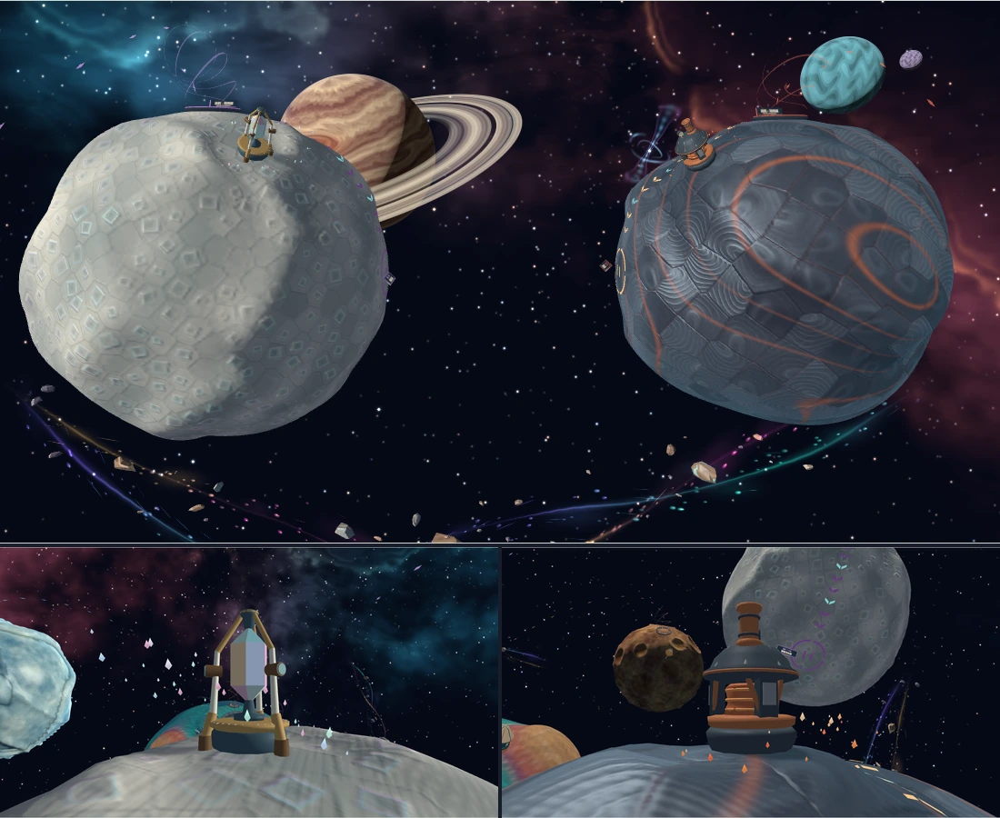

# 琉璃小行星

从场景菜单选「琉璃小行星」。从罗盘地台出发，沿金色子午线穿过两根测星柱，走过青绿矿脊和撞击盆地，球背有一座带光环的信标。普通模式左摇杆行走，右手 A 低重力跳跃，右摇杆横拨转向。初次建议慢走或常速，绕行时地平线会随脚下方向改变。

角色和导入物件可放在北端直径 5.6 米的平坦观星台，玩家能绕行全球。金属罗盘和刻度是平面的，地台外的山脊则有真实起伏。屏幕「游览机位」可看环行星、铜穹观测站和南极信标；后两处按当地地面设定镜头上方，仍可拖动、滚轮缩放、WASD 平移、Q/E 原地转头。R 回到北端入口。

## 从罗盘起飞：五条往返风道

[先导入角色／进 VR](https://mmd-xr-stage.pages.dev/?set=glassPlanet) · [屏幕直接进星系](https://mmd-xr-stage.pages.dev/?set=glassPlanet&view=screen)

从出生点面对两根测星柱，罗盘前半圈有琥珀环和冰蓝环，后半圈有淡紫环和朱红环。普通模式站进环内，按一次**左手 X**。风道先抬升，再沿弧线越过母星边缘，在目标星球的返航环落地。站在环外按 X 不会起飞；地面的右手 A 是跳跃。

- **赭砾星**：约 8.5 秒抵达。赤褐色坑底、明亮坑缘和喷出纹围着三脚测震仪展开。用左杆绕过测震仪，能走向球背；回到写有「返航 · 琉璃星」的环内按 X 回家。
- **霜岬星**：约 9.5 秒抵达。沿冰蓝裂带、浅色压力脊，走到地平线上的接收天线。这里沿自身球面的法线行走、转向和跳跃，返航操作相同。
- **棱盐星、玄釉星**：后半圈左边的淡紫风环前往棱盐星，右边的朱红风环前往玄釉星，单程约 10.5 秒。两颗星的北侧各有直接回母星的风口，也可以从一颗星的赤道跳到另一颗，换一条风道回家。
- **苇湾星**：后半圈中间的 **05 号青绿环**通往草坡和浅湖，单程约 9 秒。站在北极返航环望向水尺，沿草岸走向香蒲与睡莲。水面有独立波纹，脚下踩的是湖床；可以涉水，从岸边的冠木之间绕回风环。
- **屏幕**：选「游览机位 → 起飞风道」下对应星球的机位，点回画面按 **G**。到站后按**空格**试当地的垂直跳，在原落点再按 **G** 返回。若用鼠标离开了环，可选对应的「回望母星」机位。**R** 结束当前镜头行程并回入口。

母星与五颗卫星属于同一活动布景，演员始终在母星北台。地面与风口使用舞台米制；更远的天体用于取景，按双眼位置独立投影，没有可以落脚的地表。尺度和飞行时间为观看、行走而缩小，不模拟真实天体轨道。

### 苇湾星与地表近景

屏幕「游览机位」可选 **苇湾星 · 环湖全景／荷塘水尺／草坡看林冠**。睡莲浮在浅水上，豆娘沿湖面巡飞。水面和土壤是两层网格：土壤保留沙岸到湖床的高度，水面只画有水的三角形。水深影响水色，波纹改变高光和岸线；树干有碰撞，草叶和豆娘没有。

旧四颗卫星的地貌原图已从 1024 × 512 重新烘焙到 1536 × 768。除此之外，母星岩面、罗盘漆层和各卫星共用[按米铺设的细节纹理](../../src/mmdVrShowcase/scenery/planet/surfaceGrain.ts)。同一颗细晶不会在经线接缝处拉长；斜视时根据像素覆盖范围过滤，到远景时淡出。新增的是矿粒和解理边缘，不改变角色材质、整幅图的锐化或渲染分辨率。

[母星和四颗卫星原尺寸局部对照：左为改前，右为改后](../screenshots/opal-grain-comparison.webp)。拍摄时只渲染对应壳面，取地表同一点、相同斜角、同一输出分辨率，裁出中央 384 × 256 像素。另分别把投影偏移 0.25 像素，与静帧重新对齐；五个样点的最差颜色通道绝对残差均值都小于 1 个 8 位色阶。这是桌面 WebGL 的细纹稳定性抽样，不等于 Quest 光学锐度或持续帧率。双眼模拟 XR 已走通 05 环往返、中途涉水和从湖床跳起。

**手写着色器在哪：** [岩面与冰壳](../../src/mmdVrShowcase/scenery/planet/WindSystem.tsx)、[盐晶与玻岩](../../src/mmdVrShowcase/scenery/planet/twinMinerals.ts)、[草岸和湖水](../../src/mmdVrShowcase/scenery/planet/Reedwater.tsx)、[碎岩和离子尘](../../src/mmdVrShowcase/scenery/planet/OrbitalDrift.tsx)使用 GLSL。母星用 Three.js 标准光照材质，在其编译阶段加入地表细节。背景的[星云](../../src/mmdVrShowcase/scenery/planet/sky/TidalNebula.tsx)和[带环行星](../../src/mmdVrShowcase/scenery/planet/sky/DistantSystem.tsx)也有各自的着色器。

### 双星引力海峡

先在棱盐星的风口旁跳一次，再在玄釉星试同样的按键。起跳力度相同，棱盐星的地表重力是 **1.25 m/s²**，玄釉星是 **3.65 m/s²**；两颗旧卫星赭砾星和霜岬星分别为 2.8 和 2.15 m/s²。它们只作用于玩家，角色的舞蹈和衣摆仍用自己的物理世界。

从棱盐星返航环沿地面的箭纹向赤道走，站到断弧里的足印上，按一次**右手 A**。这是定点辅助跨跳：用约 3 秒越过 7.2 米的空隙，过中线后由对面的星球把你拉向它的地面。两边的地面彼此相对，局部地平线会随跳跃连续转过半圈。松开再按可以回跳；沿玄釉星的箭纹反向回到北端，左 X 回母星。屏幕可选「棱盐星 · 跃向玄釉星」机位，再用**空格**来回跨跳；「双星之间 · 引力海峡」是从旁边看两颗星的全景。

想近看，选「盐晶测站」或「玄釉炉台」。盐脊上的晶面随观察角度出现薄彩边；玄釉星玻岩有贝壳状断口和氧化熔纹。棱镜和退火窑周围的晶粒与火星以同一速度范围喷出，重力较大的一侧落得更快。两星外另有缓缓翻转的碎岩和相互缠绕的彩色离子尘带，位置在三维空域里；从风口起飞横向看，能与远星错开。

**维护与验收**：[目的地、重力、测站与航线](../../src/mmdVrShowcase/scenery/planet/windAtlas.ts)供渲染和移动共用；[脚下地形与网格](../../src/mmdVrShowcase/scenery/planet/moonSurface.ts)共用同一高度函数。原卫星用[反照率](../../src/mmdVrShowcase/scenery/planet/bakeSatellites.py)，双星用[多通道矿物纹样](../../src/mmdVrShowcase/scenery/planet/bakeTwinCuts.py)。[跨跳](../../src/mmdVrShowcase/movement/twinLeap.ts)用 1/120 秒步长，按当前引力井积分；抵达实际壳面才算着陆。[专项测试](../../src/mmdVrShowcase/movement/twinLeap.test.ts)覆盖中心和边缘起跳、不同帧率和两米身高净空。风道和卫星停留期间母星 Ecctrl 停用，返航再从实际脚位接管。诊断区分 `windDepartures/windLandings`、`twinDepartures/twinLandings`，并记录 `location` 和 `gravityOwner`。Quest 3S 上的近眼舒适度及持续帧率仍待实机检查。

## 下一轮母星提案（未实施）

北台把视线留给角色、罗盘和前方双柱。五个风口平时只露编号与指向，走近或选中一个，才显出它的流线和目的地；喷流和高密度星尘留给仰头观星、飞行的机位。母星近景目前是重复裂纹上叠矿粒，虽然更清楚，却缺少整块岩层的轮廓。建议以烟青色哑光岩为底，从北台到球背铺一条连续乳白蛋白石脊，青紫变彩只出现在断面，铜色只标人工刻度。验收看两个距离：北台低头能分岩脊与路标，从卫星回看能凭白脊认出母星。

第一件交互建议**留在母星：沿白脊采谱**。在北台罗盘取测晶片，走到已有的矿簇，把晶片转到与矿脉对齐的位置；对齐时，一道颜色穿过晶片。沿脊走到下一处取第二色，回来把晶片插回罗盘，两色出现在角色背后的测星柱上。只采一处就只亮一柱，取下晶片就熄灭。这样一次短途步行就有可以留下拍照的结果。之后若做[霜岬回波](../gameplay/interactive-scene-studies.md)，再让罗盘兼作远程接收器。

**重力优先级：** 母星按半径衰减、卫星普通跳使用各自恒定的表面重力，双星踏印辅助跨跳才在飞行中切换引力井。普通风道是固定曲线，自由飞行不受引力。已有功能足以游览，下一步先实测冷进／重进的两杆输入及跨跳翻转舒适度；还应复核跳起未落稳时按 X（目前风环检查距离，不要求 `grounded`）。全星系多体模拟不是当前游览玩法的必要条件。

## 深空 · 潮汐星云与脉冲星

选「观星台望行星环」，看琥珀色行星的大气涡旋、环缝和环背后的阴影。保持朝向用 A／D 横移，行星、暗尘和远处的星点会分别错开；也可以沿风道升空再回望。第二个观测方向是「**深空 · 脉冲星双向喷流**」：蓝白核心的两边各有一束弯曲喷流，亮结缓慢向外走，赤道附近是两段断续的弧光。

[脉冲星喷流与赤道弧光机位实景](../screenshots/planet-pulsar.webp)。

- **星点**：[星表](../../src/mmdVrShowcase/scenery/planet/sky/StarCatalogue.tsx)有 8,831 颗，位置、亮度和色温固定，一次绘制。星芯按每眼视口的像素宽度过滤；远星基本不动，较近的星群有视差。穿过前方尘带的星光会减弱。
- **云气**：[潮汐星云](../../src/mmdVrShowcase/scenery/planet/sky/TidalNebula.tsx)分别采样后方发光云壳和前方吸收尘埃；[烘焙源](../../src/mmdVrShowcase/scenery/planet/sky/bakeSkyFields.py)只生成密度、亮丝和风暴云带数据。星点、行星和环都单独绘制。
- **天体**：[远行星](../../src/mmdVrShowcase/scenery/planet/sky/DistantSystem.tsx)按当前眼睛的视线求与球面、环面的交点，实时判定环的前后遮挡、环影和行星本影。四个远月共用一批；[双向喷流](../../src/mmdVrShowcase/scenery/planet/sky/Pulsar.tsx)用带深度的曲线。天空在场景实体前先绘制，前景演员和近星自然遮住它。自由飞行的远景视差有上限，不会飞出天空。

**验证范围**：在相同的 1,100 × 606 WebGL 画面里，固定时间、朝向，仅平移眼睛 6 米。旧版 `a04fc04` 单独渲染的天空完全相同，新版环行星亮部形心横移约 27 像素。单独渲染天空为 5 次绘制。另取五档亮度、连续 18 个亚像素转头位置，在每颗星周围 14 × 14 像素内积分，检查不掉点；逐项核对实际着色器的编译、链接及双眼视口。这些是桌面 WebGL／模拟 XR 的结果，Quest 3S 的锐度、闪烁和帧率以实机为准。

### 早期地形与天空记录

[北端罗盘与环行星](../screenshots/opal-compass.webp) · [南极信标与远月](../screenshots/opal-south.webp)（正式构建的屏幕机位）

- [径向地形](../../src/mmdVrShowcase/scenery/planet/opalTerrain.ts)用同一高度函数生成球壳、Rapier 三角面及加载前的贴地支撑。240 个方向的测试将数学半径与渲染网格的实际射线交点对照，允许误差 3.5 cm。建筑、晶簇不占用北端双人站位；瞄准观星台时会拒绝穿过山脊或仪器的射线。
- 早期天空由 [`bakeFirmament.py`](../../src/mmdVrShowcase/scenery/planet/bakeFirmament.py) 将恒星、尘带和五个远天体合成全景图，仅随眼睛朝向旋转；这是上方同机位对照的旧版。母星地面的罗盘和矿纹仍使用 [`bakeLanding.py`](../../src/mmdVrShowcase/scenery/planet/bakeLanding.py)。
- 三轮屏幕实景修订：先对照旧版测山形和天空；再纠正环行星被初始镜头裁切、地台缺少比例参照的问题；最后把侧面／南极机位改为局部水平，修补迟到贴图并对行星环离线抗锯齿。双眼模拟 Quest 用实际摇杆沿子午线走到球背，沿线采样地形高差约 1.18 m；正常载入与阻断物理模块各走一遍，均可原地跳起、落地、转向 30°、按 B 召回。测试不等于 Quest 3S 真机帧率或舒适度。

[球面移动](../../src/mmdVrShowcase/movement/PlanetMotor.tsx)从第一帧就读取当前会话的手柄，Quest 使用原生 `xr-standard` 摇杆轴 2/3；其他布局可使用当前输入源的已解析摇杆。物理模块还在下载、编译或启动失败时，沿球面和平台走、转、跳、召回和飞行仍可使用。[Ecctrl/Rapier](../../src/mmdVrShowcase/movement/PlanetPhysics.tsx)就绪后从当前脚位、切面朝向、速度接手。两种路径共用 XR 原点和转向锁存；母星参考表面的重力为 2.5 m/s²，随脚位到星心的距离增加按平方反比变弱，不进入角色 Bullet 世界。

仅在 XR 进入本景时加载 Rapier（同源 JS 内联 WASM，本次约 1.60 MB gzip）；静态入口不能依赖它，由 Vite 构建检查。Ecctrl 每个渲染帧施加一次冲量，给它过长的物理步长会放大支撑弹簧，故每帧最多推进 1/60 秒。落点射线只接受北端平台；普通移动对导入物件使用实际三角面，对角色使用躯干代理。

**真机已知现象**：2026-11-20 14:43Z 的 Quest 3S 报告记录了两次空景访问、21 个采样窗，FPS 中位数 117。用户确认 B 可用、左右摇杆都不能移动或转向。旧报告没有摇杆、姿态或玩家物理状态，不能据此定位为 WASM、追踪或手柄配置故障。

**验证**：双眼模拟 Quest 的生产构建中，刻意挂起 1,569,397 字节的 Rapier WASM 实例化，左右摇杆仍可行走与 30° 转向；放行的那一帧视点位移和转角均为零。另一次直接拒绝实例化，走、转以及离开后再回来仍有效。另用模拟手柄走至球背（局部向上轴的世界 Y = −0.9996），转向 30°、按 A 径向升高 0.247 米、落回原高度，并用 B 召回后点开「更多」。此前的[球面探针](../../experiments/three-planet-wheel/README.md)在 72/90 步下走过整周。桌面模拟不证明真机原因已排除或头显舒适度合格。

**真机复测**：新开页面进空星球，左摇杆向前 2 秒，右摇杆横拨、松开再横拨，按 A 跳和 B 召回。切到平地再进星球重复，退出并导出 JSON。`windows[].planetMovement` 是本次进星球以来的累计记录：`backend` 为 `pending` / `rapier` / `failed`；`poseFrames` 对照 `frames`，`left/right` 表示输入来源，`walkInputFrames`、`turnInputFrames` 为检测到摇杆的帧数，`inputHeldFrames` 为界面拖动或退出锁住输入的帧数。`snapTurns` 和 `footTravelM`（包括升降、跳跃及物理位移）记录实际执行结果。只保存计数和距离，不导出追踪坐标。
