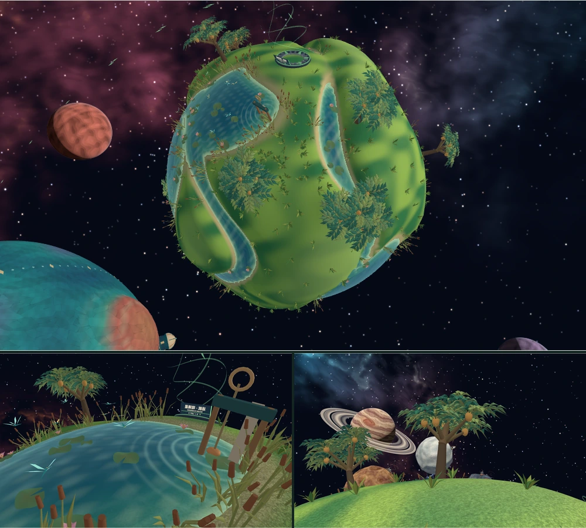
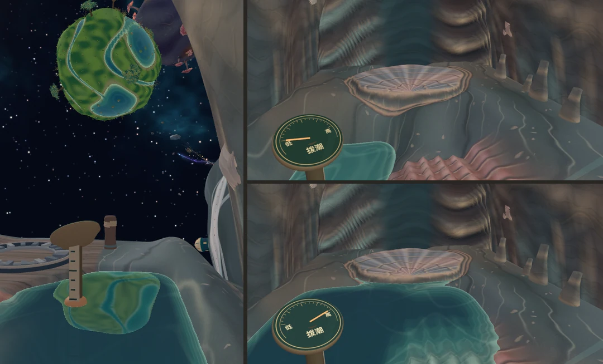
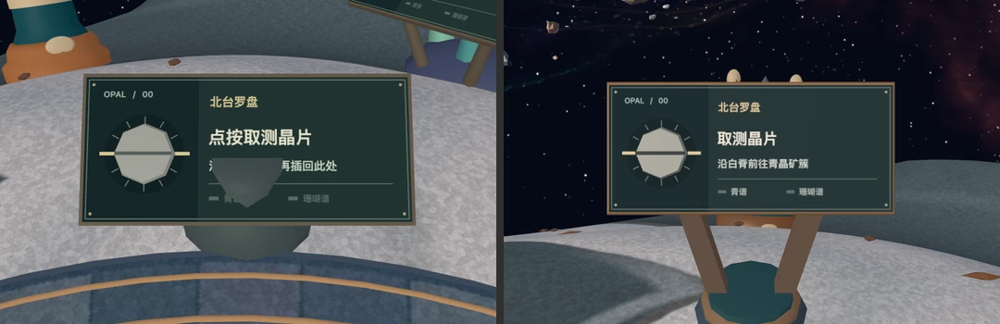
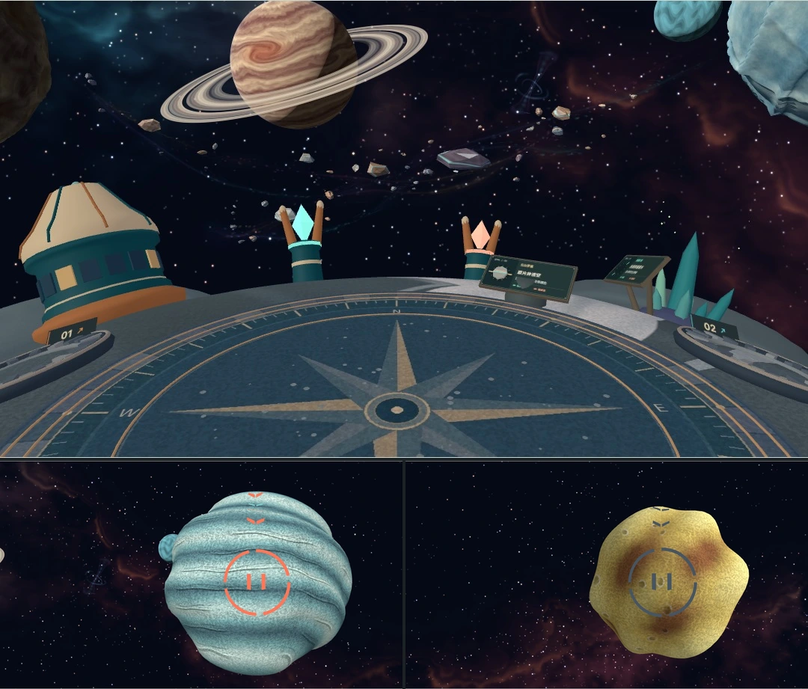

# 琉璃小行星

从场景菜单选「琉璃小行星」。北台的铜刻度连着一条贯穿烟青岩层的乳白矿脊：在罗盘取测晶片，沿脊过双柱，到两处矿簇采色，回台亮柱。普通模式左摇杆走、右手 A 低重力跳、右杆横拨转向。第一次建议用慢走或常速，绕行时地平线会随脚下方向改变。

角色和导入物件可放在母星北端直径 5.6 米的观星台、[伞灯星的菌圃台](#伞灯星和琥珀屿)或[潮汐洞星的内室干台](#潮汐洞星)。演员在这些平地都保持直立，玩家则能绕行全球。金属罗盘和刻度是平面的，地台外的山脊有真实起伏。屏幕「游览机位」可看环行星、铜穹观测站和南极信标；仍可拖动、滚轮缩放、WASD 平移、Q/E 原地转头。R 回到北端入口。

## 从罗盘起飞：七条往返风道

[先导入角色／进 VR](https://mmd-xr-stage.pages.dev/?set=glassPlanet) · [屏幕直接进星系](https://mmd-xr-stage.pages.dev/?set=glassPlanet&view=screen)

站在北台，看脚边航向盘的 **01–07**：每个编号都朝向对应的出发环，色标和环旁立式航线牌一致。屏幕「游览机位 → 母星 · 沿白脊采谱 → 北台 · 七线航向盘」能俯看全貌。**走近风环或点航线牌**会展开风迹，同时最多显示一条；牌面原地换字，不会在瞄准时翻起。要搭乘，在普通模式进环站稳，再新按一次**左手 X**。到卫星后在返航环内按 X 回家。

- **赭砾星**：约 8.5 秒抵达。赤褐色坑底、明亮坑缘和喷出纹围着三脚测震仪展开。用左杆绕过测震仪，能走向球背；回到写有「返回北台」的环内按 X 回家。
- **霜岬星**：约 9.5 秒抵达。沿冰蓝裂带、浅色压力脊，走到地平线上的接收天线。这里沿自身球面的法线行走、转向和跳跃，返航操作相同。
- **棱盐星、玄釉星**：后半圈左边的淡紫风环前往棱盐星，右边的朱红风环前往玄釉星，单程约 10.5 秒。两颗星的北侧各有直接回母星的风口，也可以从一颗星的赤道跳到另一颗，换一条风道回家。
- **苇湾星**：后半圈中间的 **05 号青绿环**通往草坡和浅湖，单程约 9 秒。站在北极返航环望向水尺，沿草岸走向香蒲与睡莲。水面有独立波纹，脚下踩的是湖床；可以涉水，从岸边的冠木之间绕回风环。
- **伞灯星**：**06 号珊瑚色环**通往伞林和苗圃，单程约 10.5 秒。从这里还能去琥珀屿；琥珀屿没有单独的母星风道。
- **潮汐洞星**：**07 号青碧风环**通往海蚀洞外的码头，单程约 10.5 秒。洞内可放演员，回头能看见苇湾星和潮池中的倒影。
- **屏幕**：选「游览机位 → 起飞风道」下对应星球的机位，点回画面按 **G**。到站后按**空格**试当地的垂直跳，在原落点再按 **G** 返回。若用鼠标离开了环，可选对应的「回望母星」机位。**R** 结束当前镜头行程并回入口。

母星、七颗风环卫星和三座跳岛共用一个布景，途中不卸载台上演员。远处的背景行星不能着陆。

**XR 地平线。** 跳跃和风道途中保持出发时的地平线。普通跳碰到地面会直接站稳；即使头或侧身先碰到邻星，也不用按 Y，左杆可以继续走。视野在触地后才缓缓回正，回正期间步行较慢；同星短跳默认保留静止时的地平线。风道和足印行程结束后，手动模式可以先停着看风景，推杆即继续，或按**左手 Y**立刻对齐；「着陆自动回正」则到站便开始转向。平滑回正最多每秒 50°，真实探头始终随头显。

### 苇湾星与地表近景

屏幕「游览机位」可选 **苇湾星 · 环湖全景／荷塘水尺／草坡看林冠**。睡莲浮在浅水上，豆娘沿湖面巡飞。水面和土壤是两层网格：土壤保留沙岸到湖床的高度，水面只画有水的三角形。水深影响水色，波纹改变高光和岸线；树干有碰撞，草叶和豆娘没有。

旧四颗卫星的地貌原图已从 1024 × 512 重新烘焙到 1536 × 768。除此之外，母星岩面、罗盘漆层和各卫星共用[按米铺设的细节纹理](../../src/mmdVrShowcase/scenery/planet/surfaceGrain.ts)。同一颗细晶不会在经线接缝处拉长；斜视时根据像素覆盖范围过滤，到远景时淡出。新增的是矿粒和解理边缘，不改变角色材质、整幅图的锐化或渲染分辨率。

[母星和四颗卫星原尺寸局部对照：左为改前，右为改后](../screenshots/opal-grain-comparison.webp)。拍摄时只渲染对应壳面，取地表同一点、相同斜角、同一输出分辨率，裁出中央 384 × 256 像素。另分别把投影偏移 0.25 像素，与静帧重新对齐；五个样点的最差颜色通道绝对残差均值都小于 1 个 8 位色阶。这是桌面 WebGL 的细纹稳定性抽样，不等于 Quest 光学锐度或持续帧率。双眼模拟 XR 已走通 05 环往返、中途涉水和从湖床跳起。

**手写着色器在哪：** [岩面与冰壳](../../src/mmdVrShowcase/scenery/planet/WindSystem.tsx)、[盐晶与玻岩](../../src/mmdVrShowcase/scenery/planet/twinMinerals.ts)、[草岸和湖水](../../src/mmdVrShowcase/scenery/planet/Reedwater.tsx)、[碎岩和离子尘](../../src/mmdVrShowcase/scenery/planet/OrbitalDrift.tsx)使用 GLSL。母星用 Three.js 标准光照材质，在其编译阶段加入地表细节。背景的[星云](../../src/mmdVrShowcase/scenery/planet/sky/TidalNebula.tsx)和[带环行星](../../src/mmdVrShowcase/scenery/planet/sky/DistantSystem.tsx)也有各自的着色器。

### 双星引力海峡

先在棱盐星的风口旁跳一次，再在玄釉星试同样的按键。起跳力度相同，棱盐星的地表重力是 **1.25 m/s²**，玄釉星是 **3.65 m/s²**；两颗旧卫星赭砾星和霜岬星分别为 2.8 和 2.15 m/s²。它们只作用于玩家，角色的舞蹈和衣摆仍用自己的物理世界。

从棱盐星返航环沿地面的箭纹向赤道走，站到断弧里的足印上，按一次**右手 A**。这是定点辅助跨跳：用约 3 秒越过 7.2 米的空隙，过中线后由对面的星球把你拉向它的地面。两边地面彼此相对，XR 回正后可从足印再按 A 回跳；也可沿玄釉星的箭纹反向回到北端，左 X 回母星。屏幕可选「棱盐星 · 跃向玄釉星」机位，再用**空格**来回跨跳；「双星之间 · 引力海峡」是从旁边看两颗星的全景。

想近看，选「盐晶测站」或「玄釉炉台」。盐脊上的晶面随观察角度出现薄彩边；玄釉星玻岩有贝壳状断口和氧化熔纹。棱镜和退火窑周围的晶粒与火星以同一速度范围喷出，重力较大的一侧落得更快。两星外另有缓缓翻转的碎岩和相互缠绕的彩色离子尘带，位置在三维空域里；从风口起飞横向看，能与远星错开。

**从玄釉星继续跳岛：** 在另一枚标有「跃向云母屿」的足印按 A，跨过约 6.95 m 到达半径 2.65 m 的云母屿。沿另一色箭纹到第二枚足印，再跨约 6.65 m 到半径 1.95 m 的硫珠屿。两段都可以反向跳，回到玄釉星后从北端风环回母星。屏幕「游览机位 → 引力海峡与跳岛」收录两向踏印；按空格完成相同的动作。跳岛没有另设北台出发口。

**维护入口：** [星表与航线](../../src/mmdVrShowcase/scenery/planet/windAtlas.ts)供渲染和移动共用；[脚下高度](../../src/mmdVrShowcase/scenery/planet/moonSurface.ts)与可见壳面一致。[跨跳](../../src/mmdVrShowcase/movement/twinLeap.ts)用 1/120 秒步长积分，触及目标壳面才着陆。[测试](../../src/mmdVrShowcase/movement/twinLeap.test.ts)覆盖踏印边缘、不同帧率与两米身高净空。母星 Ecctrl 在离星期间停用，返航时从实际脚位接管。

### 伞灯星和琥珀屿

- **看活的菌圃。** 从 06 环出来，沿浅色小路走进珊瑚色菌伞下面，仰头看从伞柄伸向边缘的细褶。翅籽从大伞边缘旋落到苗圃杯，杯唇上有一只菌蜗。屏幕的「林下看菌褶」「苗圃看落种」可直接近看。
- **把角色放在林边。** 返航环斜前方有一块直径 3 米、外缘带菌褶纹的平地。选「菌圃合影」，从背包取出演员，点台面放置；在 VR 可从返航环直接用射线摆放。角色随当前星系布局保留。树林、返航环和倾斜的球壳不是摆放点。
- **看琥珀里的叶片。** 从北环沿向西的箭纹走到赤道，站到「跃向琥珀屿」脚印，右 A／空格跨过 7.2 米间隙。琥珀屿半径 2.1 米；金色树脂断面夹着深色岩皮和蕨叶印痕。在落点重新按 A／空格可跳回，回伞灯星北环后左 X／G 返航。屏幕也可直接选两端的跳跃机位。

风道落地后，屏幕的 WASD 沿月面行走，Q/E 原地转头。想离地取景，可用 F/C 升降，或拖动、滚轮缩放恢复自由镜头。R 回母星北台。用「放在中央」时会选离镜头最近的演员台；台心被地表或菌冠挡住，会保留放置预览。

### 潮汐洞星

从 07 环到小码头后，面向洞口，沿五级贝阶穿过潮沟进入内室。落潮时中央阶面露出，左侧较深的石池仍有水。涨潮时水淹低阶，涉水越深步行越慢；想快走，就沿侧边石牙标出的高路进出。水位不抬高脚下的地面，也不移动台上演员。

潮水随场内时间往复。想对比同一镜头的两种水位，可用鼠标或 XR 扳机点码头的 **「拨潮」** 盘：水面缓缓涨落，浮标与盘针同步移动。在内室开背包，将演员放到圆形干台；水面和洞壁不能摆放。回到码头返航环后按左 X／G 返回母星。

屏幕「游览机位」有 **洞口贝阶、内室合影、苇湾与倒影**。最后一处从洞中向西回望：直接看到的绿蓝月盘是苇湾星；水中的月影按观察位置和水位计算，只有被淹的部分能映出月亮。

**实测范围。** 生产构建上点击潮盘，水位实际升高 0.62 米；仅禁用反射月盘的同机位对照中，画面下半部有超过 1.7 万个像素至少一个色道变化大于 10。水面顶点、片元着色器的编译及链接均通过。屏幕用鼠标射线把参考 PMX 放到干台中心（世界 Y = −7.90 米），之后能够返航。模拟双眼用实际手柄完成 07 风道往返、拨潮、低道入洞和高路返回，低道足面在水下约 42 厘米，回程高路在水面上约 19 厘米。以上不是 Quest 3S 真机帧率或舒适度测量。

## 母星：沿白脊采谱

1. 在北台罗盘旁点「取测晶片」。走近青晶矿簇的读头，逐次点击或用扳机松开转动晶片，直到晶片刻线与外圈的两处亮纹对齐，收下青谱。
2. 沿白脊去珊瑚矿簇取得第二色。也可以只取一种就回北台。屏幕「游览机位 → 母星 · 沿白脊采谱」可在三处停靠。
3. 将晶片插回罗盘，哪种颜色采到了，对应的测星柱就亮起，能给正在播放的角色留作背景。再取下晶片可熄灯重来，切离星系也会结束本轮。

三台读头的文字在背板正面，晶片独占左侧凹座；两支托臂从背面固定。风环和返航环的喷嘴则沿实际岩面逐点贴合，不与采谱台共用底座。普通行走会被实体立柱和背板挡住；从背面隔着牌壳不能操作，板间空隙仍可通视。

下图记录的是早期采谱和跳岛效果，牌面外形以改装后的实景为准。

白脊与测站朝向使用[同一条采样路线](../../src/mmdVrShowcase/scenery/planet/opalCourse.ts)，母星仍使用原有山形和碰撞壳。岩底改为烟青哑光，乳白断面侧看泛青紫，铜色用于刻度。北台平视时降低尘流和彩云的亮度；抬头、瞄准脉冲星或离台远行后逐渐恢复，不改变近星轮廓或角色曝光。

**离开足印自由跳（XR）：** 轻推左杆按 **A** 会向前小跳，仍落回本星。摇杆不会额外抬高普通跳；小月亮上的横向起跳速度也有限，选冲刺档不会因此绕飞。想试跨星，可从棱盐星跃向玄釉星的足印向北退约 1.4–1.5 米，用常速或更快档，朝足印方向把左杆推到底，再按 **A**。这是一次朝邻岸的起跳，空中不锁目标；横向擦过仍可能滑开。玄釉侧可反向尝试，想稳妥过岸可直接用足印。风道与自由飞行不受这项起跳限制。

### 北台仪表：验证与维护

- **底座挡字或风环缺边。** 旧罗盘铸脚突出字面约 64 毫米；改装后三台读头的托臂离字面至少 22 毫米。[读头测试](../../src/mmdVrShowcase/scenery/planet/surveyReaderModel.test.ts)从来路及两侧斜看，检查字面和独立晶片。风环原来只按环心切平面安装，在坡上会一侧埋入、一侧悬空；现按渲染壳面的实际三角形安装整圈喷嘴和彩边。七条风道的 14 个出发／返航端经[真实网格测试](../../src/mmdVrShowcase/scenery/planet/windTerminal.test.ts)：正面、左右 42°、环中和北台共 350 束射线先命中读面；反向命中背板。
- **风迹扫字。** 只让读面前方的风带与粒子按每眼视线淡出，牌壳仍不透明，沿用正常深度遮挡。01 号牌同机位启闭风迹，牌内 27,169 个像素完全一致。若复发，记录是风迹开启才出现，还是未选中就能看见底座；前者看[风迹着色](../../src/mmdVrShowcase/scenery/planet/windChartVisibility.ts)，后者查牌体安装。
- **绕行、落地与摆演员。** 底座、立柱和倾斜牌头分别有实体盒，不能用一整块盒子封住侧边。[通行测试](../../src/mmdVrShowcase/movement/planetFixtures.test.ts)从 17 块牌上方下落，以每步 1/72 秒及 1/20 秒验证滑离牌顶、落到地面；另验从侧面绕行、背包射线被牌壳挡住，以及三块演员台的有效边缘。调整返航牌时还须保留苇湾原有步道和玄釉的正常跳跃落点。
- **实际点选（`63b88ad`）。** 生产构建从「七线航向盘」用鼠标点过七条航线，走通取片、采两色、回插亮柱及 07 风道往返。模拟双眼用控制器取还晶片、点 02 号牌并抵达霜岬星。头显镜片边缘可读性仍按 [Quest 3S 短测](../performance/next-quest-export.md#北台仪表斜看与点选)验收。

## 深空 · 潮汐星云与脉冲星

选「观星台望行星环」，看琥珀色行星的大气涡旋、环缝和环背后的阴影。保持朝向用 A／D 横移，行星、暗尘和远处的星点会分别错开；也可以沿风道升空再回望。第二个观测方向是「**深空 · 脉冲星双向喷流**」：蓝白核心的两边各有一束弯曲喷流，亮结缓慢向外走，赤道附近是两段断续的弧光。

[脉冲星喷流与赤道弧光机位实景](../screenshots/planet-pulsar.webp)。

- **星点**：[星表](../../src/mmdVrShowcase/scenery/planet/sky/StarCatalogue.tsx)有 8,831 颗，位置、亮度和色温固定，一次绘制。星芯按每眼视口的像素宽度过滤；远星基本不动，较近的星群有视差。穿过前方尘带的星光会减弱。
- **云气**：[潮汐星云](../../src/mmdVrShowcase/scenery/planet/sky/TidalNebula.tsx)分别采样后方发光云壳和前方吸收尘埃；[烘焙源](../../src/mmdVrShowcase/scenery/planet/sky/bakeSkyFields.py)只生成密度、亮丝和风暴云带数据。星点、行星和环都单独绘制。
- **天体**：[远行星](../../src/mmdVrShowcase/scenery/planet/sky/DistantSystem.tsx)按当前眼睛的视线求与球面、环面的交点，实时判定环的前后遮挡、环影和行星本影。四个远月共用一批；[双向喷流](../../src/mmdVrShowcase/scenery/planet/sky/Pulsar.tsx)用带深度的曲线。天空在场景实体前先绘制，前景演员和近星自然遮住它。自由飞行的远景视差有上限，不会飞出天空。

**验证范围**：在相同的 1,100 × 606 WebGL 画面里，固定时间、朝向，仅平移眼睛 6 米。旧版 `a04fc04` 单独渲染的天空完全相同，新版环行星亮部形心横移约 27 像素。单独渲染天空为 5 次绘制。另取五档亮度、连续 18 个亚像素转头位置，在每颗星周围 14 × 14 像素内积分，检查不掉点；逐项核对实际着色器的编译、链接及双眼视口。这些是桌面 WebGL／模拟 XR 的结果，Quest 3S 的锐度、闪烁和帧率以实机为准。

### 移动实现与真机待验

[球面移动](../../src/mmdVrShowcase/movement/PlanetMotor.tsx)从第一帧读当前手柄；[地形](../../src/mmdVrShowcase/scenery/planet/opalTerrain.ts)供脚下支撑、可见壳面和碰撞共用。仅 XR 进入母星时加载 [Ecctrl/Rapier](../../src/mmdVrShowcase/movement/PlanetPhysics.tsx)，就绪后从当前脚位、朝向和速度接管，每帧最多推进 1/60 秒。模拟双眼 XR 已验延迟／拒绝加载、球背走跳与 B 召回。母星参考重力为 2.5 m/s²，不进入角色 Bullet 世界。[球面探针](../../experiments/three-planet-wheel/README.md) · [历次发布证据](../release-history.md)

**Quest 3S 实际使用反馈：** 用户确认已可正常行走，体验还可以。11 月 20 日 14:43Z 的「只有 B 有效」是旧版现象，当时两次空场共 21 个窗口、中位 117 FPS，未记录输入，原因未证实。若复发，对照 `windows[].planetMovement` 的姿态帧、摇杆计数与 `snapTurns`、`footTravelM`。可选的[跨跳与深空观感](../performance/next-quest-export.md#星球跨跳与深空观感可选)另记。
